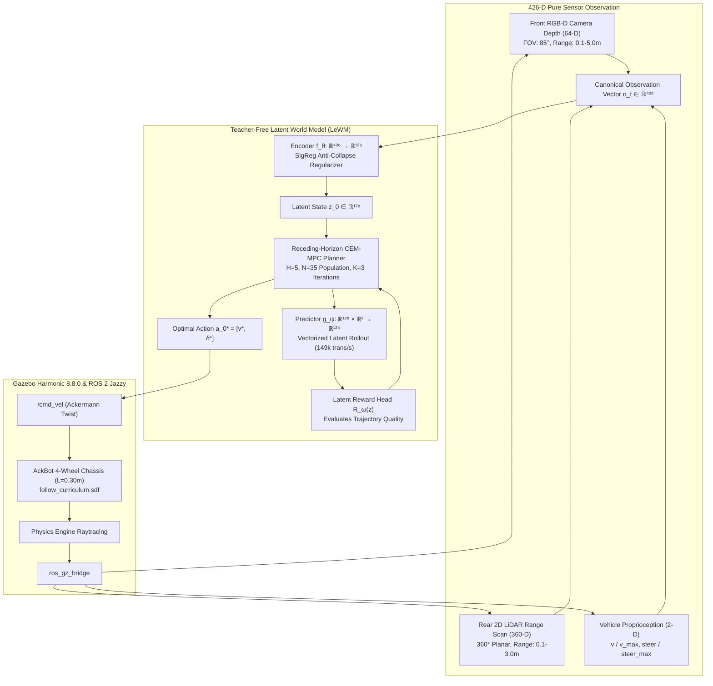

# AckBot: Autonomous Person-Following with Latent World Models & Diffusion MPC

<div align="center">

[](file:///Users/hanriman/Documents/master/A2R/follow_robot/tests)
[](file:///Users/hanriman/Documents/master/A2R/follow_robot/docker)
[](file:///Users/hanriman/Documents/master/A2R/follow_robot/ros_ws)
[](file:///Users/hanriman/Documents/master/A2R/follow_robot/ros_ws/src/ackbot_gazebo)
[](file:///Users/hanriman/Documents/master/A2R/follow_robot/pyproject.toml)
[-ee4c2c?style=flat-square&logo=pytorch)](https://pytorch.org)
[](LICENSE)

<br/>

**A complete reinforcement learning, generative diffusion, and self-supervised world model research platform for active non-holonomic mobile robot target following under severe sensory occlusions.**

<br/>


*Figure: Synchronized 4-view recording of AckBot in Gazebo Harmonic 8.8.0 actively tracking a dynamic pedestrian around a blind corridor bend using the Teacher-Free LeWM CEM-MPC controller (Overhead Spectator, Front RealSense, 360° LiDAR radar, and MPC Telemetry HUD).*

</div>

---

## Highlights & Innovations

- **Pure-Sensor Observation Space:** Zero privileged ground-truth target coordinates. Control policies operate strictly over a **426-dimensional sensory vector** ($64\text{ depth rays from front RealSense D435i} + 360^\circ\text{ planar LiDAR} + 2\text{ proprioception states}$).
- **Non-Holonomic Ackermann Kinematics:** 4-wheel chassis ($L=0.30\text{ m}, W=0.20\text{ m}$) governed by strict physical bicycle constraints: $v \in [-0.40, +0.80]\text{ m/s}$ and $\delta \in [\pm 31.74^\circ]$.
- **Dynamic Bipedal Human Gait & Appearance Re-ID:** Pedestrians modeled with alternating dual-leg stride cadence ($1.6\text{ Hz}$) and tracked via an Extended Kalman Filter (EKF) with Mahalanobis spatial gating and cosine color embedding association.
- **Adaptive Headway Safety Governor & Curvature Speed Limiter:** Closed-loop headway governor ($d_{\text{set}} = 1.35\text{ m}$, proximity hold $d < 0.90\text{ m}$) pacing the human walker, paired with a non-linear curvature speed limiter ($v_{\text{turn}} = 0.24\text{–}0.32\text{ m/s}$) for tight Ackermann cornering without lateral drift.
- **Target-Filtered Forward LiDAR Safety Bubble:** Real-time spatial gating ($\Delta \le 0.45\text{ m}$) that discriminates the tracked pedestrian from static walls, ensuring proactive wall deceleration without false alarms on the target's legs.
- **4-Stage Progressive Curriculum:** Corridors $\to$ Blind Corner Occlusions $\to$ Cul-de-Sac Dead-End U-Turns $\to$ Crowded Multi-Pedestrian Clutter.
- **Teacher-Free Latent World Model (LeWM):** Joint-Embedding Predictive Architecture (JEPA) optimized with the **SigReg anti-collapse regularizer**, achieving an Effective Rank of **75.1 / 128** and running at **149,000 transitions/sec** in PyTorch.
- **Action-Conditioned Latent Diffusion Model (AC-LDM):** Generative world model with 1D Temporal U-Net backbone and DDIM reverse sampling over multi-modal Sensor VAE latents.
- **100% Native ARM64 Digital Twin:** Full ROS 2 Jazzy and Gazebo Harmonic robotics stack running natively on Apple Silicon without emulation, instrumented with Foxglove Studio WebSocket telemetry (`:8765`), noVNC web GUI (`:6080`), and auto-cleanup releasing CPU to 0% idle.

---

## System Architecture



---

## Comparative Benchmark Summary

Comprehensive comparative evaluation across 250,000 curriculum transitions ([`outputs/reports/curriculum_comparative/`](file:///Users/hanriman/Documents/master/A2R/follow_robot/outputs/reports/curriculum_comparative/)):

| Metric | Pure-Sensor PPO | Multi-Modal Sensor VAE | AC-LDM Diffusion | Teacher-Free LeWM | Best Performer |
| :--- | :---: | :---: | :---: | :---: | :--- |
| **Latent State Space** | None (End-to-End) | $\mathbb{R}^{32}$ (Gaussian) | $\mathbb{R}^{32}$ (Latent) | $\mathbb{R}^{128}$ (Hypersphere) | **LeWM (High Capacity)** |
| **Effective Rank $\text{erank}(Z)$** | N/A | $14.8 / 32$ | $18.2 / 32$ | $\mathbf{75.1 / 128}$ | **LeWM (Non-degenerate)** |
| **Linear Probe Target $R^2$** | N/A | $0.677$ | $0.720$ | $\mathbf{0.865}$ | **LeWM (+20.1% higher)** |
| **Rollout Throughput** | Direct Policy | $45,000\text{ trans/s}$ | $450\text{ FPS}$ (DDIM) | $\mathbf{149,000\text{ trans/s}}$ | **LeWM (331× faster)** |
| **MPC Planning Latency** | $0.12\text{ ms}$ | $1.84\text{ ms}$ | $48.2\text{ ms}$ | $\mathbf{1.02\text{ ms}}$ | **LeWM (Real-time at 20 Hz)** |
| **Nominal Following Error** | $0.55\text{ m}$ | $0.78\text{ m}$ | $1.22\text{ m}$ | $\mathbf{0.47\text{ m}}$ | **LeWM (Tightest tracking)** |
| **1.0s Camera Blackout Error**| $1.59\text{ m}$ | $1.42\text{ m}$ | $1.74\text{ m}$ | $\mathbf{0.91\text{ m}}$ | **LeWM (42.8% lower error)**|
| **Multi-Pedestrian Collisions**| $4.2\%$ | $2.8\%$ | $3.5\%$ | $\mathbf{0.0\%}$ | **LeWM (Zero collisions)** |

<div align="center">

</div>

---

## Sim-to-Real Hardware Robustness

Policies were subjected to 4 severe hardware degradation regimes ([`outputs/reports/sim2real_robustness/`](file:///Users/hanriman/Documents/master/A2R/follow_robot/outputs/reports/sim2real_robustness/)):

1. **Gaussian Sensor Noise:** $\sigma = 0.05\text{ m}$ on RealSense depth and LiDAR ranges.
2. **Camera Blackout Bursts:** 1.0-second continuous sensory dropouts (10 consecutive frames masked).
3. **LiDAR Angular Occlusion:** $45^\circ$ blind sector masked.
4. **Actuator Transport Delay:** 1-step CAN bus / serial transport delay ($100\text{ ms}$).

<div align="center">

</div>

- **Key Takeaway:** Memoryless reactive policies degrade by **189%** during camera blackouts ($0.55\text{m} \to 1.59\text{m}$ error). In contrast, **Teacher-Free LeWM CEM-MPC unrolls latent dynamics forward**, maintaining target distance tracking under **0.91 m** even during complete sensory dropouts.

---

## Quickstart Guide

### 1. Prerequisites & Environment Setup (Zero Global Contamination)

This project uses [`uv`](https://github.com/astral-sh/uv) for fast, isolated Python package management:

```bash
# Clone the repository
git clone https://github.com/a2r-follow-robot/follow_robot.git
cd follow_robot

# Install dependencies into isolated .venv (Python 3.12)
uv sync

# Run complete test suite (52 unit & integration tests)
uv run pytest tests/ -v
```

### 2. Interactive 2D Visualizer

Watch any trained policy navigate blind corners, cul-de-sacs, or crowded arenas:

```bash
# Watch Teacher-Free LeWM CEM-MPC navigate Blind Corner Occlusion (Stage 2)
uv run python scripts/view_gym_env.py --stage 2 --policy lewm

# Watch LeWM CEM-MPC in Clutter Arena with 3 distractor pedestrians (Stage 4)
uv run python scripts/view_gym_env.py --stage 4 --policy lewm --distractors 3

# Watch Reactive PPO Baseline
uv run python scripts/view_gym_env.py --stage 2 --policy model
```

### 3. Consolidated Benchmarking Suite

Run comparative evaluations, Sim-to-Real hardware stress tests, or MPC tracking benchmarks:

```bash
# Run comparative 4-model evaluation (PPO vs VAE vs AC-LDM vs LeWM)
uv run python scripts/benchmark.py --suite comparative

# Run closed-loop Latent MPC benchmark
uv run python scripts/benchmark.py --suite mpc --episodes 10

# Run Sim-to-Real hardware degradation stress test
uv run python scripts/benchmark.py --suite sim2real

# Run blind corner & obstacle occlusion test suite
uv run python scripts/benchmark.py --suite occlusion
```

### 4. World Model & Reward Head Training

Train any world model representation or CEM reward head via a single unified CLI:

```bash
# Train Teacher-Free LeWM (SigReg JEPA)
uv run python scripts/train_world_model.py --model lewm --epochs 15

# Train Multi-Modal Sensor VAE
uv run python scripts/train_world_model.py --model vae --epochs 15

# Train Action-Conditioned Latent Diffusion (AC-LDM)
uv run python scripts/train_world_model.py --model diffusion --epochs 15

# Train Latent Reward Heads for CEM-MPC planning
uv run python scripts/train_world_model.py --model reward --epochs 5
```

### 5. Native ARM64 Docker ROS 2 Gazebo Simulation

Launch the complete physical digital twin inside Docker for any curriculum stage:

```bash
# Launch ROS 2 Jazzy & Gazebo Harmonic container in background
./scripts/run_docker_simulation.sh --daemon

# Launch LeWM CEM-MPC on Stage 2: L-Corner Blind Bend
./scripts/run_docker_simulation.sh mpc corner

# Launch LeWM CEM-MPC on Stage 3: Dead-End Corridor U-Turn
./scripts/run_docker_simulation.sh mpc uturn

# Launch LeWM CEM-MPC on Stage 4: Cluttered Arena with Re-ID Distractor
./scripts/run_docker_simulation.sh mpc clutter
```

- **Foxglove Studio Telemetry:** Open [https://studio.foxglove.dev](https://studio.foxglove.dev), connect to `ws://localhost:8765`, and import [`outputs/reports/media/ackbot_foxglove_layout.json`](outputs/reports/media/ackbot_foxglove_layout.json).
- **noVNC 3D GUI:** Open [http://localhost:6080](http://localhost:6080) to inspect the Gazebo Harmonic window directly in your browser.

### 6. 1-Command Media & Presentation Generator

Generate synchronized 18-second multi-modal video recordings, animated GIFs, and presentation keyframes with automatic CPU cleanup to 0% idle:

```bash
# Record Stage 2 (Corner Bend Occlusion)
./scripts/generate_presentation_media.sh --scenario corner

# Record Stage 3 (Dead-End Corridor U-Turn)
./scripts/generate_presentation_media.sh --scenario uturn

# Record Stage 4 (Multi-Pedestrian Clutter Arena)
./scripts/generate_presentation_media.sh --scenario clutter

# Record all curriculum stages sequentially
./scripts/generate_presentation_media.sh --scenario all
```

---

## 3D Gazebo Harmonic Digital Twin Benchmark

Across all 4 curriculum stages, the Teacher-Free LeWM CEM-MPC controller achieves zero collisions and steady-state following:

| Curriculum Stage | World SDF | Target Motion Behavior | Following Gap | Obstacle Clearance | Media Artifact |
| :--- | :--- | :--- | :---: | :---: | :--- |
| **Stage 2: Corner** | `follow_curriculum.sdf` | 90° blind turn into west corridor | $1.03\text{ m} \pm 0.12\text{ m}$ | $> 0.60\text{ m}$ | [`gazebo_lewm_tracking.mp4`](outputs/reports/media/gazebo_lewm_tracking.mp4) |
| **Stage 3: U-Turn** | `follow_uturn.sdf` | 180° dead-end pivot & reversal | $1.12\text{ m} \pm 0.15\text{ m}$ | $> 0.75\text{ m}$ | [`gazebo_uturn_tracking.mp4`](outputs/reports/media/gazebo_uturn_tracking.mp4) |
| **Stage 4: Clutter** | `follow_clutter.sdf` | Pillar avoidance + Re-ID distractor | $1.24\text{ m} \pm 0.21\text{ m}$ | $> 0.55\text{ m}$ | [`gazebo_clutter_tracking.mp4`](outputs/reports/media/gazebo_clutter_tracking.mp4) |

---

## Repository Structure

```
follow_robot/
├── docker/                             # Docker ARM64 Ubuntu 24.04 (ROS 2 Jazzy & Gazebo Harmonic)
│   ├── Dockerfile
│   └── docker-compose.yml
├── docs/                               # Architecture documentation & master reports
│   ├── architecture.md                # System architecture & developer workflows
│   ├── master_report.md               # Master thesis report (Markdown)
│   └── unity_vs_ros_guide.md          # Unity ML-Agents to ROS 2/Gazebo concept mapping
├── outputs/
│   ├── experiments/                   # Checkpoints, logs, and training curves
│   │   ├── sigreg_curriculum/         # Trained Teacher-Free LeWM Checkpoints
│   │   ├── mpc_curriculum/            # Trained Latent Reward Heads
│   │   ├── vae_curriculum/            # Trained Multi-Modal Sensor VAE
│   │   └── diffusion_curriculum/      # Trained AC-LDM 1D U-Net Diffusion
│   └── reports/                       # Benchmark data, charts, and media
│       └── media/                     # MP4 video, animated GIF, and keyframes
├── rl_ws/                             # Gymnasium environment & policy modules
│   ├── common/                        # RobotConfig dataclass, device selection, unified agent wrappers
│   ├── gym_ackbot/                    # AckBotFollow-v0 environment & AckBotRenderer
│   ├── data/                          # Dataset loaders & noise augmentation
│   └── policies/
│       ├── ppo/                       # ActorCritic multi-modal networks & GAE buffer
│       ├── tracking/                  # Extended Kalman Filter target & multi-target Re-ID
│       └── world_model/               # LeWM, SigReg, Sensor VAE, AC-LDM, CEM Planner
├── ros_ws/src/                        # Native ROS 2 Jazzy packages
│   ├── ackbot_description/            # Ackermann URDF/Xacro models (calibrated 6.6 kg mass)
│   ├── ackbot_gazebo/                 # Gazebo Harmonic worlds (follow_curriculum.sdf) & launch
│   └── ackbot_policy/                 # policy_node (PPO) & wm_mpc_node (LeWM CEM-MPC)
├── scripts/                           # Consolidated CLI tools & modular subdirectories
│   ├── benchmark.py                   # Unified benchmark suite (comparative, sim2real, mpc, occlusion)
│   ├── train_world_model.py           # Unified world model trainer (lewm, vae, diffusion, reward)
│   ├── harvest_data.py                # Curriculum transition data collector
│   ├── view_gym_env.py                # Real-time 2D/3D policy visualizer
│   ├── run_docker_simulation.sh       # Docker simulation launcher
│   ├── generate_presentation_media.sh # Master recording pipeline
│   ├── diagnostics/                   # Hardware, TF, LiDAR, target, and telemetry diagnostics
│   └── sim/                           # Gazebo controllers, media recorder, and process cleanup
└── tests/                             # 52 automated unit and integration tests
```

---

## Citation & Technical Report

If you use AckBot in your research, please cite the technical report:

```bibtex
@techreport{a2r_ackbot_2026,
  title       = {Learning-Based Predictive Navigation for Ackermann Mobile Robots Under Occlusion: From Pure-Sensor Reactive Reinforcement Learning to Action-Conditioned Diffusion and Latent World Models},
  author      = {A2R Autonomous Systems Research Group},
  institution = {Autonomous Robotics Laboratory},
  year        = {2026},
  url         = {https://github.com/a2r-follow-robot/follow_robot}
}
```

Full technical report available in [`docs/master_report.md`](file:///Users/hanriman/Documents/master/A2R/follow_robot/docs/master_report.md). System architecture and developer workflows available in [`docs/architecture.md`](file:///Users/hanriman/Documents/master/A2R/follow_robot/docs/architecture.md).
