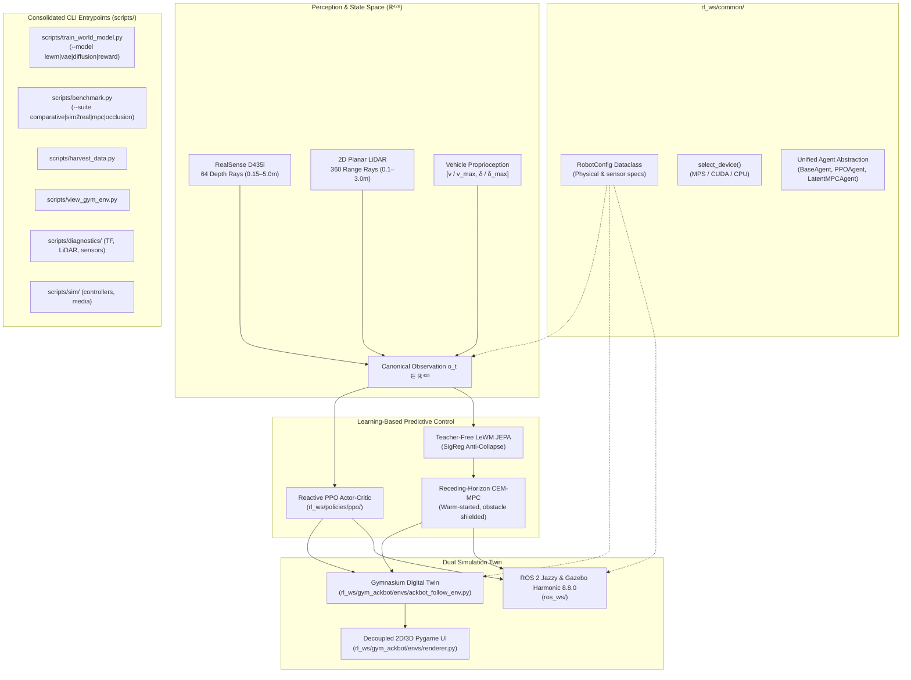

# AckBot Architecture & Developer Guide

This document describes the software architecture, modular package structure, coordinate frames, physical kinematics, and development workflows for the **AckBot** platform.

---

## 1. System Architecture Overview



---

## 2. Directory & Module Breakdown

### 2.1 Common Foundation (`rl_ws/common/`)

| File | Purpose | Key Exports |
| :--- | :--- | :--- |
| [`config.py`](file:///Users/hanriman/Documents/master/A2R/follow_robot/rl_ws/common/config.py) | Canonical hardware, sensor, and training configurations matching `spec.txt` | [`RobotConfig`](file:///Users/hanriman/Documents/master/A2R/follow_robot/rl_ws/common/config.py#L12), [`select_device()`](file:///Users/hanriman/Documents/master/A2R/follow_robot/rl_ws/common/config.py#L58) |
| [`agents.py`](file:///Users/hanriman/Documents/master/A2R/follow_robot/rl_ws/common/agents.py) | Polymorphic agent interface across reactive and world-model planners | [`BaseAgent`](file:///Users/hanriman/Documents/master/A2R/follow_robot/rl_ws/common/agents.py#L15), [`RandomAgent`](file:///Users/hanriman/Documents/master/A2R/follow_robot/rl_ws/common/agents.py#L27), [`HeuristicPursuitAgent`](file:///Users/hanriman/Documents/master/A2R/follow_robot/rl_ws/common/agents.py#L35), [`PPOAgent`](file:///Users/hanriman/Documents/master/A2R/follow_robot/rl_ws/common/agents.py#L48), [`LatentMPCAgent`](file:///Users/hanriman/Documents/master/A2R/follow_robot/rl_ws/common/agents.py#L65) |

### 2.2 Gymnasium Environment (`rl_ws/gym_ackbot/`)

| Module | Responsibility |
| :--- | :--- |
| [`envs/ackbot_follow_env.py`](file:///Users/hanriman/Documents/master/A2R/follow_robot/rl_ws/gym_ackbot/envs/ackbot_follow_env.py) | Core physical step dynamics, Ackermann kinematics, bipedal target walker, 4 curriculum stages, and unified raycasting (`_cast_rays`). Refactored to 884 lines. |
| [`envs/renderer.py`](file:///Users/hanriman/Documents/master/A2R/follow_robot/rl_ws/gym_ackbot/envs/renderer.py) | Modular [`AckBotRenderer`](file:///Users/hanriman/Documents/master/A2R/follow_robot/rl_ws/gym_ackbot/envs/renderer.py#L14) handling 2D top-down rendering, 3D isometric arena projection, camera viewport, polar LiDAR radar scope, and live MPC telemetry. |
| [`envs/human_target.py`](file:///Users/hanriman/Documents/master/A2R/follow_robot/rl_ws/gym_ackbot/envs/human_target.py) | Pedestrian walker with 1.6 Hz alternating dual-leg gait cadence and RGB clothing appearance variation. |

### 2.3 Learning Policies & World Models (`rl_ws/policies/`)

| Directory | Modules | Description |
| :--- | :--- | :--- |
| `tracking/` | [`target_tracker.py`](file:///Users/hanriman/Documents/master/A2R/follow_robot/rl_ws/policies/tracking/target_tracker.py) | EKF target tracker with predictive time-updates, Mahalanobis spatial gating, appearance Re-ID, and local ego-centric frame status output. |
| `ppo/` | [`actor_critic.py`](../rl_ws/policies/ppo/actor_critic.py), [`buffer.py`](../rl_ws/policies/ppo/buffer.py) | Recurrent Spatial `ActorCritic` (1D CoordConv + circular LiDAR conv, polar soft-argmin, `GRU(128, 128)` memory, decoupled actor/critic trunks, `TanhNormal` action distribution) and multi-env sequence-chunked `RolloutBuffer` with exact GAE terminal masking (`1.0 - dones[t]`). Detailed in [`docs/ppo_recurrent_upgrade.md`](ppo_recurrent_upgrade.md). |
| `world_model/` | [`sigreg_wm.py`](file:///Users/hanriman/Documents/master/A2R/follow_robot/rl_ws/policies/world_model/sigreg_wm.py), [`sigreg.py`](file:///Users/hanriman/Documents/master/A2R/follow_robot/rl_ws/policies/world_model/sigreg.py), [`cem_planner.py`](file:///Users/hanriman/Documents/master/A2R/follow_robot/rl_ws/policies/world_model/cem_planner.py) | Teacher-Free LeWM JEPA architecture, SigReg anti-collapse regularizer, and warm-started CEM-MPC planner. |
| `vla/` | [`diffusion_wm.py`](file:///Users/hanriman/Documents/master/A2R/follow_robot/rl_ws/policies/vla/diffusion_wm.py) | Action-conditioned 1D Temporal U-Net diffusion world model with DDIM sampling. |

### 2.4 ROS 2 Packages (`ros_ws/src/`)

| Package | Purpose |
| :--- | :--- |
| `ackbot_description` | URDF/Xacro models: calibrated mass ($6.6\text{ kg}$ total, $3.508\text{ kg}$ base), $4\text{ mm}$ deck plates, and $0.15\text{ m}$ camera near clip. |
| `ackbot_gazebo` | Gazebo Harmonic 8.8.0 worlds (`follow_curriculum.sdf`, `follow_uturn.sdf`, `follow_clutter.sdf`) and launch orchestration. |
| `ackbot_policy` | Production deployment nodes: [`policy_node.py`](file:///Users/hanriman/Documents/master/A2R/follow_robot/ros_ws/src/ackbot_policy/ackbot_policy/policy_node.py) (PPO) and [`wm_mpc_node.py`](file:///Users/hanriman/Documents/master/A2R/follow_robot/ros_ws/src/ackbot_policy/ackbot_policy/wm_mpc_node.py) (LeWM CEM-MPC with visual perception fallback). |

### 2.5 Script Hierarchy (`scripts/`)

```
scripts/
├── benchmark.py                       # Unified benchmark suite (comparative, sim2real, mpc, occlusion)
├── train_world_model.py               # Unified world model trainer (lewm, vae, diffusion, reward)
├── harvest_data.py                    # Curriculum transition harvester
├── view_gym_env.py                    # Real-time 2D/3D policy visualizer
├── run_docker_simulation.sh           # Docker Gazebo Harmonic simulation launcher
├── generate_presentation_media.sh     # Presentation media generator
│
├── diagnostics/                       # Hardware inspection & offline dataset analysis
│   ├── check_odom.py                  # Verify /odom ROS 2 topic
│   ├── check_tf.py                    # Validate TF transform tree
│   ├── dump_scan.py                   # Dump raw 2D LiDAR ranges
│   ├── inspect_lidar.py               # LiDAR angle & min/max range inspector
│   ├── inspect_sensors.py             # Dual RealSense depth & LiDAR inspector
│   ├── locate_target.py               # World coordinates target locator
│   ├── track_human.py                 # Standalone ROS 2 human tracker node test
│   ├── diagnose_trajectory.py         # Trajectory dataset analysis & plotting
│   └── plot_curriculum_training.py    # Training curve plotter
│
└── sim/                               # Gazebo controllers & simulation utilities
    ├── clean_simulation_processes.py  # Zero-CPU cleanup utility
    ├── record_simulation_media.py     # Synchronized 4-view media capture
    ├── sim_wander.py                  # Random wander controller
    ├── test_improved_wander.py        # Obstacle-avoiding wander controller
    ├── test_vel_ctrl.py               # Direct cmd_vel velocity test
    ├── test_env_rollout.py            # Environment step & rollout tester
    ├── test_human_motion.py           # Bipedal target gait motion test
    ├── test_mpc_planning.py           # Standalone CEM planner test
    └── visualize_robot.py             # URDF & robot coordinate viewer
```

---

## 3. Physical Specifications & Robot Geometry

```
                  Front RealSense D435i
                   [FOV 85°, 0.15–5.0m]
                            ▲
                            │
               ┌────────────┴────────────┐
               │    AckBot Chassis       │
               │   L = 0.30m, W = 0.20m  │
               │   Mass: 6.6 kg Total    │
               └────────────┬────────────┘
                            │
                            ▼
                    Rear RPLiDAR 2D
                 [FOV 360°, 0.10–3.0m]
```

* **Kinematics:** 4-wheel Ackermann (front-wheel steer, rear-wheel drive).
* **Wheelbase ($L$):** $0.30\text{ m}$.
* **Track Width ($W$):** $0.20\text{ m}$.
* **Wheel Radius ($R$):** $0.05\text{ m}$.
* **Velocity Limits ($v$):** $[-0.40, +0.80]\text{ m/s}$.
* **Steering Limits ($\delta$):** $\pm 0.553953\text{ rad}$ ($\pm 31.74^\circ$).
* **Total Robot Mass:** $6.600\text{ kg}$ (Chassis assembly: $5.000\text{ kg}$, 4 wheels: $1.600\text{ kg}$).
* **Deck Plate Thickness:** $4\text{ mm}$ ($0.004\text{ m}$).
* **Control Loop Frequency:** $20\text{ Hz}$ ($\Delta t = 0.05\text{ s}$).

---

## 4. Developer Workflows

### 4.1 Running Tests & Linting

```bash
# Run complete test suite (52 tests across env, geometry, Re-ID, world model, URDF)
uv run pytest tests/ -v

# Run fast Ruff linter
uv run ruff check rl_ws scripts tests
```

### 4.2 Running Benchmarks

```bash
# 4-Model Comparative Benchmark (PPO vs VAE vs AC-LDM vs LeWM)
uv run python scripts/benchmark.py --suite comparative

# Closed-Loop CEM-MPC Tracking Benchmark
uv run python scripts/benchmark.py --suite mpc --episodes 10

# Sim-to-Real Hardware Stress Test
uv run python scripts/benchmark.py --suite sim2real

# Blind Corner & Pedestrian Occlusion Test
uv run python scripts/benchmark.py --suite occlusion
```

### 4.3 Training World Models

```bash
# Train Teacher-Free LeWM (JEPA + SigReg)
uv run python scripts/train_world_model.py --model lewm --epochs 15

# Train Multi-Modal Sensor VAE
uv run python scripts/train_world_model.py --model vae --epochs 15

# Train AC-LDM Diffusion Dynamics
uv run python scripts/train_world_model.py --model diffusion --epochs 15

# Train CEM-MPC Latent Reward Heads
uv run python scripts/train_world_model.py --model reward --epochs 5
```

### 4.4 Interactive Visualization & Digital Twin

```bash
# 2D/3D Pygame Environment Viewer
uv run python scripts/view_gym_env.py --stage 2 --policy lewm

# Launch Native ARM64 Docker Simulation
./scripts/run_docker_simulation.sh mpc corner

# Capture Multi-View Presentation Recording
./scripts/generate_presentation_media.sh --scenario corner
```
