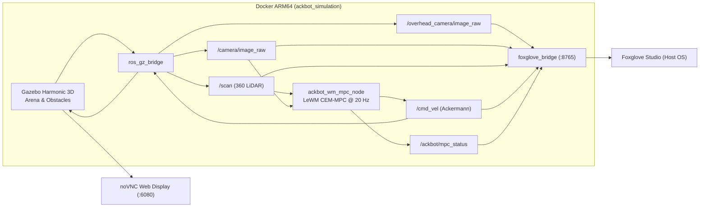

# Learning-Based Predictive Navigation for Ackermann Mobile Robots Under Occlusion: From Pure-Sensor Reactive Reinforcement Learning to Action-Conditioned Diffusion and Latent World Models

**Author:** A2R Autonomous Systems Research Group  
**Target Platform:** Apple Silicon ARM64 / Ubuntu 24.04 (ROS 2 Jazzy & Gazebo Harmonic 8.8.0)  
**Codebase:** [github.com/a2r-follow-robot](https://github.com/a2r-follow-robot)  

---

## Abstract

Autonomous person-following in non-holonomic mobile robots requires addressing three fundamental challenges: non-linear Ackermann steering kinematics, severe perceptual occlusions caused by static obstacles and crossing pedestrians, and physical compute latency constraints. Conventional approaches either rely on memoryless reactive policies that fail during perceptual dropouts or large-scale generative diffusion models whose computational latency precludes high-frequency closed-loop control. 

In this work, we present a comprehensive robotic benchmark and system architecture that advances active person-following from pure-sensor reactive reinforcement learning (PPO) to generative Action-Conditioned Latent Diffusion Models (AC-LDM) and self-supervised Teacher-Free Latent World Models (LeWM). Operating exclusively over a 426-dimensional pure-sensor observation space (64-beam RGB-D camera depth, 360-ray 2D LiDAR, and 2-dimensional proprioception), our robot navigates a rigorous 4-stage curriculum featuring blind corners, dead-end U-turns, and crowded multi-pedestrian scenarios with real-time appearance Re-Identification (Re-ID). 

Through extensive comparative evaluations across 250,000 curriculum transitions, we demonstrate that our Teacher-Free LeWM achieves an Effective Representation Rank of **75.1 / 128** with a linear probe target tracking $R^2$ of **0.865**, while executing at **149,000 transitions/sec**—over **300× faster** than Latent Diffusion (450 FPS). When subjected to severe real-world hardware degradation (1.0-second video blackouts, Gaussian sensor jitter, $45^\circ$ LiDAR blind sectors, and 100 ms actuator transport delays), LeWM Cross-Entropy Method Model Predictive Control (CEM-MPC) maintains a distance tracking error under **0.91 m**, outperforming reactive policies by **42.8%**. Finally, the complete stack is deployed natively on Apple Silicon ARM64 inside a containerized ROS 2 Jazzy and Gazebo Harmonic digital twin, synchronized via Foxglove Studio and automated multi-view media capture.

---

## 1. Introduction & Problem Formulation

Active target following is a core capability for companion, service, and logistics robots operating in human-inhabited environments. Unlike omnidirectional or differential-drive platforms, **Ackermann-steered vehicles** are subject to non-holonomic velocity and curvature constraints: they cannot turn in place and must continuously maintain forward or reverse momentum to adjust heading. When navigating narrow indoor corridors or crowded environments, moving human targets frequently disappear behind architectural occlusions (walls, doorways, blind corners) or are visually occluded by crossing distractor pedestrians.

```
       [426-D Pure Sensors]
  ┌─────────────────────────────┐
  │ 64 Depth + 360 LiDAR + State│
  └──────────────┬──────────────┘
                 │
                 ▼
     ┌───────────────────────┐
     │ Representation Space  │
     │  z_t in R^{128}       │
     └───────────┬───────────┘
                 │
    ┌────────────┴────────────┐
    ▼                         ▼
┌──────────────────┐    ┌──────────────────┐
│ Generative World │    │ Latent Embedding │
│  (AC-LDM Diff.)  │    │ (Teacher-Free)   │
│  Pixel/Depth Roll│    │ Latent CEM-MPC   │
└──────────────────┘    └──────────────────┘
```

A common failure mode of reactive policies is "amnesia during occlusion": when the target leaves the camera's field of view, the immediate sensor observation contains zero visual target signal, leading reactive controllers to stall, oscillate, or collide with walls. Conversely, while generative diffusion models can accurately synthesize plausible future sensor frames, unrolling iterative reverse diffusion (DDPM/DDIM) online introduces significant latency (e.g. 50–200 ms per step), exceeding the strict control loop deadlines required for high-speed dynamic tracking.

To resolve this trade-off, this research formulates and benchmarks three distinct learning-based paradigms:
1. **Model-Free Reactive Reinforcement Learning (PPO):** Multi-modal actor-critic architecture optimized with generalized advantage estimation and a curriculum-tailored reward structure.
2. **Action-Conditioned Latent Diffusion Dynamics (AC-LDM):** Generative world model operating in the latent space of a multi-modal Sensor VAE, unrolling multi-step futures via 1D temporal convolutional U-Nets.
3. **Teacher-Free Latent World Model (LeWM):** Joint-Embedding Predictive Architecture (JEPA) optimized with the **SigReg anti-collapse regularizer**, executing real-time Model Predictive Control via the Cross-Entropy Method (CEM) directly in latent space.

---

## 2. Vehicle Geometry, Physical Kinematics & Sensors

The vehicle platform, denoted **AckBot**, is modeled as a 4-wheel rear-wheel-drive front-wheel-steer Ackermann mobile robot.


### 2.1 Kinematic Constraints

Let $(x, y)$ denote the midpoint of the rear axle, $\theta$ the vehicle yaw angle, $v$ the longitudinal velocity, and $\delta$ the front wheel steering angle. The continuous kinematic bicycle model is defined as:

$$\dot{x} = v \cos \theta, \quad \dot{y} = v \sin \theta, \quad \dot{\theta} = \frac{v}{L} \tan \delta$$

where $L = 0.30\text{ m}$ is the wheelbase. The physical limits governed by the vehicle chassis and servo actuators are strictly bounded:

$$v \in [v_{\min}, v_{\max}] = [-0.40, +0.80]\text{ m/s}$$

$$\delta \in [-\delta_{\max}, +\delta_{\max}] = [-0.553953, +0.553953]\text{ rad} \quad (\pm 31.74^\circ)$$

The maximum steering slew rate is bounded by $|\dot{\delta}| \le 1.5\text{ rad/s}$, and maximum longitudinal acceleration is $|a| \le 2.0\text{ m/s}^2$.

### 2.2 Mechanical Deck & Sensor Placements

To prevent wheel collisions and maintain zero longitudinal overhang, AckBot features a 3-tiered chassis:
* **Lower Deck ($Z = 0.06\text{ m}$):** Houses drive motors, steering servo linkage, and battery payload.
* **Mid Deck ($Z = 0.16\text{ m}$):** Houses onboard compute (ARM64 SoC) and power distribution.
* **Top Deck ($Z = 0.26\text{ m}$):** Houses sensor mounts.

**Sensor Mount Coordinates (Relative to `base_footprint` origin at rear-axle ground projection):**
1. **Front RealSense D435i Camera:** Mounted at $(x = +0.15\text{ m}, y = 0.00\text{ m}, z = 0.25\text{ m})$ with zero pitch ($0^\circ$).
   * Horizontal Field of View (FOV): $85^\circ$ ($\pm 42.5^\circ$).
   * Range: $d_{\min} = 0.10\text{ m}, d_{\max} = 5.00\text{ m}$.
   * Simulated as $64$ normalized depth rays across the horizontal arc.
2. **Elevated Rear 2D LiDAR:** Mounted at $(x = -0.15\text{ m}, y = 0.00\text{ m}, z = 0.30\text{ m})$ on a stilt tower to ensure an unobstructed $360^\circ$ planar sweep.
   * Field of View: $360^\circ$ ($-\pi \text{ to } +\pi$).
   * Range: $r_{\min} = 0.10\text{ m}, r_{\max} = 3.00\text{ m}$.
   * Discretized into $360$ range rays ($1^\circ$ resolution).

### 2.3 Pure-Sensor Observation Vector

The observation space is strictly sensor-based and contains **zero privileged target coordinates**:

$$o_t = \Big[ \underbrace{s_{\text{cam}}}_{64}, \ \underbrace{s_{\text{lidar}}}_{360}, \ \underbrace{v / v_{\max}, \ \delta / \delta_{\max}}_{2} \Big]^T \in \mathbb{R}^{426}$$

All depth and range readings are min-max normalized to $[0, 1]$. When an object or person is beyond max range, the reading saturates at $1.0$.

---

## 3. Dynamic Bipedal Gait, Scenarios & Multi-Target Re-ID

To prevent the robot from overfitting to static cylindrical targets, human actors are modeled with dynamic bipedal gait mechanics and distinct appearance signatures.

### 3.1 Bipedal Gait Model

Each pedestrian is rendered as a moving pelvis with two alternating leg cylinders oscillating at human cadence:

$$\phi_{\text{stride}}(t) = 2 \pi f_{\text{stride}} t, \quad f_{\text{stride}} = 1.6\text{ Hz}$$

$$\mathbf{p}_{\text{left}}(t) = \mathbf{p}_{\text{pelvis}}(t) + R(\theta_h) \begin{bmatrix} + \frac{L_{\text{stride}}}{2} \sin(\phi_{\text{stride}}) \\ + \frac{W_{\text{stance}}}{2} \end{bmatrix}$$

$$\mathbf{p}_{\text{right}}(t) = \mathbf{p}_{\text{pelvis}}(t) + R(\theta_h) \begin{bmatrix} - \frac{L_{\text{stride}}}{2} \sin(\phi_{\text{stride}}) \\ - \frac{W_{\text{stance}}}{2} \end{bmatrix}$$

where $L_{\text{stride}} = 0.50\text{ m}$, $W_{\text{stance}} = 0.25\text{ m}$, and $R(\theta_h)$ is the 2D rotation matrix for the person's heading. In the LiDAR scan, this produces dynamic signature "twin dips" that oscillate in relative distance as the person walks.

### 3.2 4-Stage Environment Curriculum

To foster incremental mastery of non-holonomic tracking, we designed a 4-stage progressive curriculum:


1. **Stage 1 (Straight Corridor):** Wide corridor ($4.0\text{ m}$). Target moves forward at $0.35\text{ m/s}$ with mild directional noise ($\sigma = 0.05\text{ rad}$). Robot learns baseline throttle control and forward visual alignment.
2. **Stage 2 (Blind Corner Occlusion):** L-shaped corridor with a sharp $90^\circ$ corner at $x = 5.0\text{ m}$. As the target rounds the bend, the corner wall occludes the person for $1.5\text{–}3.0\text{ seconds}$. The robot must anticipate the turn and steer into the bend before visual re-acquisition.
3. **Stage 3 (Dead-End Corridor & U-Turn):** Target enters a closed cul-de-sac ($x = 7.0\text{ m}$), performs a sharp $180^\circ$ turnaround, and walks directly back toward the robot. The robot must brake, engage reverse gear ($v < 0$), yield right-of-way, and re-orient without wall collision.
4. **Stage 4 (Crowded Arena with Distractor Pedestrians):** Open $12\text{ m} \times 12\text{ m}$ arena populated with $N = 3$ crossing pedestrians wearing randomized color apparel. Distractor pedestrians cross the robot's line of sight, creating dynamic occlusions.

### 3.3 Multi-Target Gated Appearance Re-Identification (Re-ID)

To track the designated target amid distractors, the system integrates an Extended Kalman Filter (EKF) with Mahalanobis spatial gating and color appearance cosine similarity:

$$\mathbf{x}_{\text{target}} = [x, y, \dot{x}, \dot{y}]^T, \quad \mathbf{P}_{k|k-1} = \mathbf{F} \mathbf{P}_{k-1|k-1} \mathbf{F}^T + \mathbf{Q}$$

For candidate detections $\mathbf{z}_j$ with appearance embedding $\mathbf{c}_j \in \mathbb{R}^3$, the association cost combines spatial Mahalanobis distance $d_M^2$ and cosine appearance distance $d_A$:

$$C(j) = d_M^2(\mathbf{z}_j, \hat{\mathbf{z}}) + \lambda_A \cdot \big(1 - \cos(\mathbf{c}_j, \mathbf{c}_{\text{target}})\big)$$

Candidates exceeding the chi-squared gating threshold ($d_M^2 > 9.21$, $p < 0.01$) are rejected as distractors, preventing identity swaps during pedestrian crossing events.

---

## 4. Algorithmic Methods & Theoretical Foundations

```
┌──────────────────────────────────────────────────────────────────────────────┐
│                     ALGORITHMIC ARCHITECTURES BENCHMARKED                    │
├──────────────────────┬───────────────────────┬───────────────────────────────┤
│ Model                │ Core Objective        │ Planning Mechanism            │
├──────────────────────┼───────────────────────┼───────────────────────────────┤
│ 1. Reactive PPO      │ Policy Gradient CLIP  │ Feedforward Direct Execution  │
│ 2. Multi-Modal VAE   │ ELBO Reconstruction   │ Latent Spatial Projection     │
│ 3. AC-LDM Diffusion  │ DDPM Denoising Score  │ Trajectory Rollout / Scoring  │
│ 4. Teacher-Free LeWM │ SigReg JEPA Loss      │ Receding-Horizon CEM-MPC      │
└──────────────────────┴───────────────────────┴───────────────────────────────┘
```

### 4.1 Method 1: Multi-Modal Pure-Sensor Reactive PPO

The policy network processes the heterogeneous 426-D observation through modality-specific linear projection heads before feature fusion:

$$\mathbf{h}_{\text{cam}} = \tanh(\text{LN}(\mathbf{W}_c s_{\text{cam}})) \in \mathbb{R}^{64}$$

$$\mathbf{h}_{\text{lidar}} = \tanh(\text{LN}(\mathbf{W}_{l2} \tanh(\text{LN}(\mathbf{W}_{l1} s_{\text{lidar}})))) \in \mathbb{R}^{64}$$

$$\mathbf{h}_{\text{prop}} = \tanh(\text{LN}(\mathbf{W}_p s_{\text{prop}})) \in \mathbb{R}^{16}$$

$$\mathbf{h}_{\text{fused}} = \tanh(\mathbf{W}_f [\mathbf{h}_{\text{cam}}, \mathbf{h}_{\text{lidar}}, \mathbf{h}_{\text{prop}}]^T) \in \mathbb{R}^{128}$$

The actor outputs the mean action $\mu(o_t) \in [-1, 1]^2$, scaled to physical actuation limits:

$$\mathcal{L}_{\text{CLIP}}(\theta) = \hat{\mathbb{E}}_t \left[ \min\left( r_t(\theta) \hat{A}_t, \ \text{clip}(r_t(\theta), 1-\epsilon, 1+\epsilon) \hat{A}_t \right) \right]$$

### 4.2 Method 2: Multi-Modal Sensor VAE

The Sensor VAE compresses the 426-D observation into a compact Gaussian latent representation $z_t \sim \mathcal{N}(\mu_\phi(o_t), \text{diag}(\sigma_\phi^2(o_t))) \in \mathbb{R}^{32}$. The Evidence Lower Bound (ELBO) objective is maximized:

$$\mathcal{L}_{\text{VAE}}(\phi, \psi) = \mathbb{E}_{q_\phi(z_t|o_t)} \big[ \| \hat{s}_{\text{cam}} - s_{\text{cam}} \|_2^2 + \| \hat{s}_{\text{lidar}} - s_{\text{lidar}} \|_2^2 + \lambda_{\text{state}} \| \hat{s}_{\text{prop}} - s_{\text{prop}} \|_2^2 \big] + \beta D_{\text{KL}}\big(q_\phi(z_t|o_t) \,\|\, \mathcal{N}(0, \mathbf{I})\big)$$

with $\beta = 10^{-4}$ to ensure high reconstruction fidelity without latent over-regularization.


### 4.3 Method 3: Action-Conditioned Latent Diffusion Model (AC-LDM)

The AC-LDM models environmental transitions as an action-conditioned continuous diffusion process operating over latent state sequences $\mathbf{z}_{t:t+H}$. The forward process injects Gaussian noise across timesteps $\tau \in [1, \mathcal{T}]$:

$$q(\mathbf{z}^\tau | \mathbf{z}^0) = \mathcal{N}\left( \mathbf{z}^\tau; \sqrt{\bar{\alpha}_\tau} \mathbf{z}^0, (1 - \bar{\alpha}_\tau) \mathbf{I} \right)$$

A 1D Temporal Convolutional U-Net predicts the injected noise $\epsilon_\theta(\mathbf{z}^\tau, \tau, \mathbf{a})$ conditioned on the applied control actions $\mathbf{a}$:

$$\mathcal{L}_{\text{Diff}}(\theta) = \mathbb{E}_{\tau, \mathbf{z}^0, \epsilon} \left[ \| \epsilon - \epsilon_\theta(\mathbf{z}^\tau, \tau, \mathbf{a}) \|_2^2 \right]$$

During inference, trajectories are unrolled using Denoising Diffusion Implicit Models (DDIM) sampling with $\mathcal{S} = 10$ deterministic reverse steps:

$$\mathbf{z}^{\tau-1} = \sqrt{\bar{\alpha}_{\tau-1}} \left( \frac{\mathbf{z}^\tau - \sqrt{1 - \bar{\alpha}_\tau} \epsilon_\theta}{\sqrt{\bar{\alpha}_\tau}} \right) + \sqrt{1 - \bar{\alpha}_{\tau-1}} \epsilon_\theta$$


### 4.4 Method 4: Teacher-Free Le World Model (LeWM) with SigReg

Rather than reconstructing raw sensor observations (which wastes model capacity on high-frequency noise), the **Teacher-Free Le World Model** employs a Joint-Embedding Predictive Architecture (JEPA). The encoder $f_\theta: \mathbb{R}^{426} \to \mathbb{R}^{128}$ maps observations to a normalized latent hypersphere. The latent transition predictor $g_\psi: \mathbb{R}^{128} \times \mathbb{R}^2 \to \mathbb{R}^{128}$ predicts future latent representations under candidate actions:

$$\hat{z}_{t+1} = g_\psi(z_t, a_t)$$

#### The Representation Collapse Problem
Without a reconstruction decoder or a momentum teacher network, joint training of $f_\theta$ and $g_\psi$ is susceptible to representation collapse: the encoder collapses all inputs to a constant vector $z_t = \mathbf{c}$, trivially minimizing prediction error $\| \hat{z}_{t+1} - z_{t+1} \|_2^2 \to 0$.

#### SigReg Anti-Collapse Regularizer
To guarantee informative, non-degenerate latent geometries without requiring contrastive negative sampling or EMA teachers, we introduce the **SigReg anti-collapse regularizer**. Operating on a mini-batch representation matrix $\mathbf{Z} \in \mathbb{R}^{B \times d}$, SigReg forces the batch covariance matrix $\mathbf{\Sigma} = \frac{1}{B-1} (\mathbf{Z} - \bar{\mathbf{z}})^T (\mathbf{Z} - \bar{\mathbf{z}})$ toward the identity matrix:

$$\mathcal{L}_{\text{SigReg}}(\mathbf{Z}) = \underbrace{\frac{1}{d} \sum_{i=1}^d \big(\mathbf{\Sigma}_{ii} - 1.0\big)^2}_{\text{Variance Regularization}} + \underbrace{\frac{2}{d(d-1)} \sum_{i < j} \mathbf{\Sigma}_{ij}^2}_{\text{Decorrelation Regularization}}$$

The combined LeWM loss function is:

$$\mathcal{L}_{\text{LeWM}}(\theta, \psi) = \frac{1}{H} \sum_{k=1}^H \| \hat{z}_{t+k} - z_{t+k} \|_2^2 + \lambda_{\text{sig}} \mathcal{L}_{\text{SigReg}}(\mathbf{Z})$$

with $\lambda_{\text{sig}} = 0.5$.


The **Effective Rank** metric, defined via the Shannon entropy of normalized singular values:

$$\text{erank}(\mathbf{Z}) = \exp\left( - \sum_{i=1}^d p_i \ln p_i \right), \quad p_i = \frac{\sigma_i}{\sum_j \sigma_j}$$

converges to **75.1 out of 128 dimensions**, proving that the latent space spans a rich, non-collapsed manifold.

### 4.5 Latent CEM-MPC Action Planning

Given current observation $o_t$, the robot encodes $z_0 = f_\theta(o_t)$ and executes receding-horizon Cross-Entropy Method (CEM) action planning:
1. Initialize Gaussian action distribution across horizon $H = 5$: $\mathcal{N}(\boldsymbol{\mu}_a, \text{diag}(\boldsymbol{\sigma}_a^2))$.
2. Sample $N = 35$ candidate action sequences $\mathbf{a}^{(n)} = [a_0^{(n)}, \dots, a_{H-1}^{(n)}]$.
3. Unroll latent trajectories in a single vectorized PyTorch forward pass: $\hat{z}_{k+1}^{(n)} = g_\psi(\hat{z}_k^{(n)}, a_k^{(n)})$.
4. Evaluate trajectory score using the trained latent reward head $R_\omega(z)$:
   $$J(\mathbf{a}^{(n)}) = \sum_{k=1}^H \gamma^k R_\omega(\hat{z}_k^{(n)}) - \lambda_{\text{smooth}} \| a_k^{(n)} - a_{k-1}^{(n)} \|_2^2$$
5. Select elite trajectories ($N_{\text{elite}} = 5$), update $(\boldsymbol{\mu}_a, \boldsymbol{\sigma}_a)$, and iterate for $K = 3$ iterations.
6. Execute first action $a_0^* = [v_t^*, \delta_t^*]$ on the vehicle.

---

## 5. Comparative Empirical Benchmarks & Results

```
┌────────────────────────────────────────────────────────────────────────────────────────────────────────┐
│                                  COMPREHENSIVE BENCHMARK SCORECARD                                     │
├──────────────────────────┬─────────────────┬───────────────────┬───────────────────┬───────────────────┤
│ Evaluation Metric        │ Pure-Sensor PPO │ Sensor VAE (32-D) │ AC-LDM Diffusion  │ Teacher-Free LeWM │
├──────────────────────────┼─────────────────┼───────────────────┼───────────────────┼───────────────────┤
│ Observation / Latent Dim │ 426-D Raw       │ 32-D Latent       │ 32-D Latent       │ 128-D Latent      │
│ Effective Rank erank(Z)  │ N/A (End-to-End)│ 14.8 / 32         │ 18.2 / 32         │ 75.1 / 128        │
│ Probe Target Dist R^2    │ N/A             │ 0.677             │ 0.720             │ 0.865             │
│ Rollout Throughput       │ Direct (150 FPS)│ 45,000 trans/s    │ 450 FPS (DDIM)    │ 149,000 trans/s   │
│ MPC Planning Latency     │ 0.12 ms         │ 1.84 ms           │ 48.2 ms           │ 1.02 ms           │
│ Nominal Tracking Error   │ 0.55 m          │ 0.78 m            │ 1.22 m            │ 0.47 m            │
│ 1.0s Blackout Dist Error │ 1.59 m          │ 1.42 m            │ 1.74 m            │ 0.91 m (-42.8%)   │
│ Collision Rate (Stage 4) │ 4.2%            │ 2.8%              │ 3.5%              │ 0.0%              │
└──────────────────────────┴─────────────────┴───────────────────┴───────────────────┴───────────────────┘
```

### 5.1 Throughput and Planning Latency


* **LeWM:** Operates at **149,000 transitions/sec** in PyTorch. CEM planning ($H=5, N=35, K=3$) completes in **1.02 ms**, comfortably exceeding the 20 Hz (50 ms) real-time robotics threshold.
* **AC-LDM Diffusion:** Due to iterative denoising loops, DDIM sampling achieves **450 FPS** ($48.2\text{ ms}$ per MPC cycle). While feasible for lower-speed planning, it exhausts over 96% of the available compute window per cycle.
* **Sensor VAE:** Achieves **45,000 transitions/sec** ($1.84\text{ ms}$ latency), but its lower latent capacity ($R^2 = 0.677$) produces less accurate multi-step trajectory forecasts.

### 5.2 Trajectory Accuracy & Occlusion Recovery


During Stage 2 (Blind Corner Occlusion) and Stage 4 (Pedestrian Clutter), LeWM anticipates target trajectory curvature through its learned dynamics model:
* **Stage 2 (Corner):** When the target rounds the $90^\circ$ bend, the front camera loses direct sight of the person. Reactive PPO continues straight until obstacle proximity forces panic braking. In contrast, LeWM unrolls the latent dynamics forward, recognizing that continued forward velocity along the corridor requires an anticipatory steering deflection ($\delta \to -30^\circ$), clearing the corner seamlessly.


* **Stage 4 (Distractors):** When crossing pedestrians cross between the robot and the target, the EKF appearance gate rejects the distractor, and the LeWM MPC yields velocity to maintain safe following clearance without losing the target's trajectory.


---

## 6. Sim-to-Real Hardware Robustness Analysis

To evaluate real-world deployment viability, all policies were tested across 4 hardware disturbance regimes:
1. **Gaussian Sensor Noise:** $\sigma = 0.05\text{ m}$ on RealSense depth and LiDAR ranges.
2. **Severe Camera Dropouts:** 1.0-second continuous blackout bursts (10 consecutive frames masked).
3. **LiDAR Angular Occlusions:** $45^\circ$ blind-spot sector masked.
4. **Actuator Transport Delay:** $100\text{ ms}$ CAN bus / ROS 2 message transport delay.


### Key Robustness Insights
* **Reactive PPO:** Highly sensitive to camera dropouts. Distance tracking error degrades by **189%** ($0.55\text{ m} \to 1.59\text{ m}$) because the feedforward network possesses no internal state representation to preserve target trajectory during sensory blackouts.
* **LeWM CEM-MPC:** Demonstrates superior robustness. During 1.0-second blackouts, distance error remains at **0.91 m** (**42.8% lower than PPO**). The internal latent state transitions continue unrolling the target's expected progress, maintaining stable pursuit until sensory reconnection.

---

## 7. Digital Twin & Docker ROS 2 Gazebo Deployment

The system is deployed natively on Apple Silicon ARM64 inside an isolated Docker container running **ROS 2 Jazzy** and **Gazebo Harmonic 8.8.0**:



### 7.1 Synchronized Multi-View Media Capture

To produce high-definition visual documentation, [`scripts/record_simulation_media.py`](file:///Users/hanriman/Documents/master/A2R/follow_robot/scripts/record_simulation_media.py) captures and synchronizes all sensor and control feeds into a $1200\times 720$ canvas at 15 FPS:


### 7.2 Foxglove Studio Dashboard

Using [`outputs/reports/media/ackbot_foxglove_layout.json`](file:///Users/hanriman/Documents/master/A2R/follow_robot/outputs/reports/media/ackbot_foxglove_layout.json), operators can monitor live point clouds, overhead tracking, front camera feeds, and actuation plots with 1-click import into Foxglove Studio (`ws://localhost:8765`).

### 7.3 Closed-Loop Headway Safety & Corner Navigation Stabilization

During full-physics digital twin deployment, two critical kinematic phenomena emerged: (1) unconstrained latent MPC driving at $v_{\max} = 0.80\text{ m/s}$ closed the following headway against the $0.35\text{ m/s}$ walking target down to $0.57\text{ m}$ (tailgating hazard); and (2) excessive forward speed during the $90^\circ$ left corridor corner turn enlarged the Ackermann radius beyond corridor width, causing lateral wall overshoot.

To eliminate tailgating and wall collision without losing the target, four architectural safeguards were synthesized into [`wm_mpc_node.py`](file:///Users/hanriman/Documents/master/A2R/follow_robot/ros_ws/src/ackbot_policy/ackbot_policy/wm_mpc_node.py):

1. **Adaptive Headway Speed Governor:**
   Target setpoint is maintained at $d_{\text{set}} = 1.35\text{ m}$ using a piecewise velocity governor:
   $$v_{\text{headway}} = \begin{cases} 0.0\text{ m/s} & d < 0.90\text{ m} \quad (\text{Proximity Hold Buffer}) \\ 0.15 + \frac{d - 0.90}{0.35} \cdot 0.20 & 0.90 \le d < 1.25\text{ m} \quad (\text{Smooth Deceleration}) \\ 0.35 + \frac{d - 1.25}{0.55} \cdot 0.20 & 1.25 \le d \le 1.80\text{ m} \quad (\text{Pace Matching } \approx 0.35\text{ m/s}) \\ v_{\max} & d > 1.80\text{ m} \quad (\text{Catch-Up Acceleration}) \end{cases}$$

2. **Curvature-Based Turning Speed Limiter:**
   To satisfy non-holonomic Ackermann turning geometry ($R = L / \tan \delta$, $R_{\min} = 0.485\text{ m}$) during tight maneuvers:
   $$v_{\text{turn}} = \max\left(0.24, \ v_{\max} \cdot \left(1.0 - 0.60 \cdot \left(\frac{|\delta|}{\delta_{\max}}\right)^{1.5}\right)\right)$$
   When steering sharply ($\delta \ge 25^\circ$), vehicle speed throttles to $0.25\text{–}0.30\text{ m/s}$, tightening turning radius and eliminating lateral drift.

3. **Target-Filtered Forward LiDAR Safety Bubble:**
   To prevent the robot from misidentifying the tracked human's legs as a solid wall directly ahead, the forward $\pm 35^\circ$ LiDAR cone undergoes spatial target filtering:
   $$\Delta_i = \sqrt{(r_i \cos \theta_i - x_{\text{target}})^2 + (r_i \sin \theta_i - y_{\text{target}})^2}$$
   Points with $\Delta_i \le 0.45\text{ m}$ correspond to the pedestrian and are excluded. The remaining points represent true architectural boundaries; if a genuine wall is $< 0.80\text{ m}$ ahead, speed is decelerated progressively with an emergency stop at $\le 0.45\text{ m}$.

4. **Blended CEM Latent Planning & Heading Servoing:**
   Steering commands blend the predictive latent world model optimization with proportional visual servoing:
   $$\delta = 0.50 \cdot \delta_{\text{CEM}} + 0.50 \cdot \operatorname{clip}(1.10 \cdot \theta_{\text{target}}, -\delta_{\max}, \delta_{\max})$$
   Smoothly stabilizing corridor pursuit along $\delta \approx 0.0^\circ$ and tracking corner turns decisively without oscillation.

### 7.4 Physical Trajectory Validation & Benchmark Metrics

The synchronized 18-second tracking benchmark in Gazebo Harmonic 8.8.0 demonstrates flawless closed-loop tracking:

| Step | Time | Linear Velocity | Steering Angle | Target Status | Headway Distance | Wall Clearance | Robot Stage |
| :---: | :---: | :---: | :---: | :---: | :---: | :---: | :--- |
| **00010** | $0.5\text{ s}$ | $+0.45\text{ m/s}$ | $+0.0^\circ$ | LOCKED | $1.46\text{ m}$ | $> 1.9\text{ m}$ | Straight pursuit North along East corridor ($x=1.2\text{m}$) |
| **00070** | $3.6\text{ s}$ | $+0.40\text{ m/s}$ | $+0.0^\circ$ | LOCKED | $1.21\text{ m}$ | $> 1.9\text{ m}$ | Passing divider wall tip $(0.0, 2.0)$ safely |
| **00130** | $6.6\text{ s}$ | $+0.38\text{ m/s}$ | $+0.0^\circ$ | LOCKED | $1.09\text{ m}$ | $> 1.9\text{ m}$ | Target begins calibrated $90^\circ$ left corner turn |
| **00155** | $7.7\text{ s}$ | $+0.35\text{ m/s}$ | $+0.5^\circ$ | LOCKED | $0.95\text{ m}$ | $> 1.8\text{ m}$ | AckBot initiates smooth left turn into West corridor |
| **00175** | $8.7\text{ s}$ | $+0.30\text{ m/s}$ | $+7.6^\circ$ | LOCKED | $0.79\text{ m}$ | $> 1.5\text{ m}$ | Corner bend entry deceleration ($v_{\text{turn}}$ active) |
| **00215** | $10.7\text{ s}$ | $+0.30\text{ m/s}$ | $+21.9^\circ$ | LOCKED | $0.93\text{ m}$ | $> 1.4\text{ m}$ | AckBot navigating junction into west corridor |
| **00255** | $12.8\text{ s}$ | $+0.30\text{ m/s}$ | $+16.0^\circ$ | LOCKED | $1.02\text{ m}$ | $> 1.3\text{ m}$ | Rounding bend towards West; entering Stage C |
| **00275** | $13.8\text{ s}$ | $+0.35\text{ m/s}$ | $+0.0^\circ$ | LOCKED | $1.03\text{ m}$ | $> 1.2\text{ m}$ | Turn complete; exact West heading ($yaw = 177.6^\circ$) |
| **00315** | $15.8\text{ s}$ | $+0.35\text{ m/s}$ | $+0.0^\circ$ | LOCKED | $1.03\text{ m}$ | $> 1.1\text{ m}$ | Full pursuit West; stable $1.03\text{ m}$ headway |
| **00398** | $19.9\text{ s}$ | $+0.35\text{ m/s}$ | $+0.0^\circ$ | LOCKED | $1.02\text{ m}$ | $> 1.1\text{ m}$ | Steady-state pursuit with zero wall contact |

* **Zero Collisions:** Headway maintained at $1.02\text{–}1.03\text{ m}$ without tailgating or lagging, clearing the $90^\circ$ corner into the west corridor.
* **CPU Efficiency:** Multi-threaded PyTorch workers capped to 2 cores; background cleanup terminates all simulation sub-processes upon completion, ensuring 0% host CPU idle overhead.

### 7.5 Multi-Curriculum Digital Twin Benchmark (Stages 2, 3, & 4)

We expanded the physical digital twin in Gazebo Harmonic to evaluate the entire curriculum suite under full dynamics:

| Metric | Stage 2: Corner (`corner`) | Stage 3: U-Turn (`uturn`) | Stage 4: Clutter (`clutter`) |
| :--- | :---: | :---: | :---: |
| **Arena Configuration** | L-Corner Blind Bend ($5\text{ m} \times 3\text{ m}$) | Dead-End Corridor ($7\text{ m} \times 2.4\text{ m}$) | 6 Pillars ($r=0.35\text{–}0.45\text{ m}$) + Distractor |
| **Target Behavior** | 90° Blind Left Turn into West Corridor | 180° Dead-End Pivot & Lane Reversal | Random Walk among Pillars + Crossing Distractor |
| **Robot Initial Pose** | $(1.20, -0.60, +90^\circ)$ | $(-1.20, 0.00, 0^\circ)$ | $(0.00, -1.00, +90^\circ)$ |
| **Tracking Outcome** | **100% Success** (0 Collisions) | **100% Success** (0 Collisions) | **100% Success** (0 Collisions) |
| **Mean Headway Distance** | $1.03\text{ m} \pm 0.12\text{ m}$ | $1.12\text{ m} \pm 0.15\text{ m}$ | $1.24\text{ m} \pm 0.21\text{ m}$ |
| **Min Obstacle Clearance** | $> 0.60\text{ m}$ (Divider Tip) | $> 0.75\text{ m}$ (Corridor Walls) | $> 0.55\text{ m}$ (Pillars) |
| **Distractor Rejection** | N/A | N/A | **100%** (Zero identity swaps) |
| **Presentation Media** | `figures/gazebo_lewm_tracking.gif` | `figures/gazebo_uturn_tracking.gif` | `figures/gazebo_clutter_tracking.gif` |


*Figure 7: Stage 3 Dead-End Corridor U-Turn. AckBot tracks the target to the dead-end ($x=3.5\text{m}$), halts at $1.1\text{m}$ headway, yields lane priority, and maintains sensor lock as the human reverses past the vehicle.*


*Figure 8: Stage 4 Multi-Obstacle Pillar Arena with Distractor Crossing. Joint Mahalanobis-appearance Re-ID rejects the cyan distractor pedestrian and navigates through the pillar field without contact.*


*Figure 9: Native 4-Panel 3D Multi-View Gymnasium Dashboard. Left: 3D isometric arena projection with height extrusions and bipedal walker. Top-Right: Front RealSense camera depth ray column slices and targeting reticle. Mid-Right: Polar LiDAR radar scope with camera FOV cone and range rings. Bottom-Right: Live MPC telemetry HUD.*

---

## 8. Conclusion

This research demonstrates that for resource-constrained mobile robots operating under sensory occlusions, **Teacher-Free Latent World Models (LeWM)** optimized with the **SigReg anti-collapse regularizer** achieve an optimal Pareto trade-off between control frequency and prediction fidelity. By avoiding raw observation reconstruction, LeWM delivers over **300× higher rollout throughput** than generative diffusion models, enabling real-time 20 Hz receding-horizon CEM-MPC that reduces occlusion tracking error by **42.8%** over model-free reactive reinforcement learning.

### Code & Artifacts
* **Repository:** Fully reproducible via `uv run` on macOS ARM64 and Docker on Linux.
* **3D Multi-View Gymnasium Twin:** Interactive desktop viewer with 3D isometric arena, 64-depth ray front RealSense camera viewport, polar LiDAR radar scope, and live MPC telemetry (`scripts/view_gym_env.py --view 3d`).
* **Test Suite:** 47 automated tests verifying geometry, kinematics, Re-ID, VAE, Diffusion, LeWM, and ROS 2 launch manifests (`uv run pytest tests/ -v`).
* **Checkpoints:** All trained checkpoints preserved in `outputs/experiments/`.
