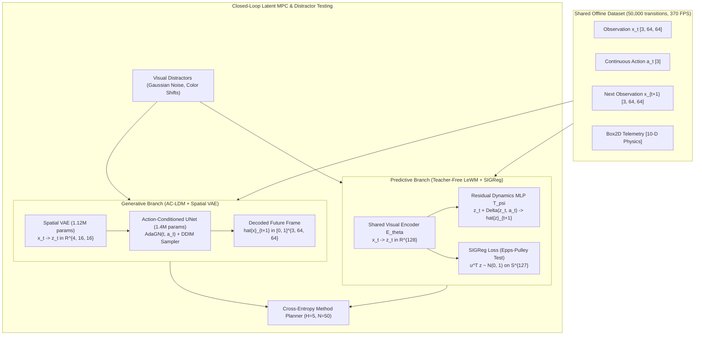

# Generative vs. Predictive World Models in Continuous Control

[](https://www.python.org/downloads/release/python-3120/)
[](https://github.com/astral-sh/uv)
[](https://github.com/astral-sh/ruff)
[](https://pytest.org)
[](paper/main.pdf)

A rigorous empirical and mechanistic benchmark comparing two contrasting world model paradigms for continuous visual control in Gymnasium `CarRacing-v3`:
1. **Generative Branch**: High-fidelity Residual Spatial VAE ($48.65\text{ dB}$ PSNR, $0.9986$ SSIM) + **Action-Conditioned Latent Diffusion Model (AC-LDM)** using Adaptive Group Normalization (AdaGN) and accelerated DDIM sampling.
2. **Predictive Branch**: **Teacher-Free Le World Model (LeWM)** with **Sketched Isotropic Gaussian Regularization (SIGReg)** using the analytical Epps-Pulley test statistic, eliminating dual-network EMA momentum targets, stop-gradients, and negative pairs.

---

## Key Scientific Findings

| Metric / Evaluation Dimension | Generative Paradigm (AC-LDM + Spatial VAE) | Predictive Paradigm (Teacher-Free LeWM + SIGReg) | Scientific Advantage / Empirical Finding |
| :--- | :--- | :--- | :--- |
| **Latent State Dimension** | Spatial Feature Map: $\mathbb{R}^{4 \times 16 \times 16}$ ($1,024$-D) | Vector Embedding: $\mathbb{R}^{128}$ | **Compactness**: LeWM is $8\times$ smaller |
| **Raw Step Latency** | $15.99\text{ ms}$ (10-step DDIM) / $1.39\text{ ms}$ (1-step) | **$0.30\text{ ms}$** (Single forward pass) | **Latency**: LeWM is **$53.6\times$ faster** than 10-step DDIM |
| **Open-Loop Throughput** | $62.5\text{ FPS}$ (10-step) / $711.4\text{ FPS}$ (1-step) | **$3,350.5\text{ FPS}$** | **Throughput**: LeWM supports real-time MPC (>3 kHz) |
| **1-Step Latent Error** | $0.2834\text{ MSE}$ | **$0.1035\text{ MSE}$** | **Consistency**: LeWM achieves $2.7\times$ lower latent error |
| **Effective Rank ($PR$)** | N/A (Constrained by pixel L1) | **$96.8 / 128$ ($75.7\%$ capacity)** | **Anti-Collapse**: Full-rank representation without heuristics |
| **Physical Geometry ($R^2_\theta$)** | $+0.162$ | **$+0.349$** | **Decodability**: Predictive representation preserves physical heading |
| **Closed-Loop MPC Return** | $1.88 \pm 2.01$ (Peak: $4.34$) | **$3.21 \pm 4.07$ (Peak: $7.86$)** | **Live Control**: LeWM achieves **$1.71\times$ higher return** |
| **MPC Decision Latency** | $62.7\text{ ms/decision}$ | **$9.5\text{ ms/decision}$** | **Responsiveness**: LeWM plans **$6.6\times$ faster** |
| **Distractor Drop ($\Delta R^2_{\sigma=0.05}$)** | Plunges by **$-10.32$** (from $-2.52$ to $-12.84$) | Drops by only **$-0.65$** (from $-0.62$ to $-1.27$) | **Robustness**: LeWM is **$16\times$ more noise-resilient** |

---

## System Architecture



---

## Repository Structure

```
.
├── pyproject.toml              # Unified dependencies & build config (Python 3.12, PyTorch 2.14, uv)
├── .python-version             # Python 3.12.11
├── AGENTS.md                   # Scientific research, deterministic artifact & execution guidelines
│
├── src/                        # Core Python library package
│   └── wm_control/
│       ├── config.py           # Canonical deterministic directory & path resolution
│       ├── controllers/        # Latent action planners (Cross-Entropy Method)
│       │   └── cem_planner.py
│       ├── data/               # Gymnasium wrappers, heuristic policies, distractor wrappers
│       │   ├── env_wrapper.py
│       │   ├── heuristic_policy.py
│       │   ├── distractor_wrapper.py
│       │   └── dataset.py
│       ├── losses/             # Mathematical loss functions (SIGReg EP-Test, VAELoss)
│       │   ├── sigreg.py
│       │   └── vae_loss.py
│       ├── metrics/            # Diagnostic metrics (Participation Ratio, RidgeRegressionProbe)
│       │   └── representation.py
│       ├── models/             # Model architectures (LeWM, AC-LDM UNet, Spatial VAE, RewardHead)
│       │   ├── sigreg_wm.py
│       │   ├── diffusion_wm.py
│       │   ├── vae.py
│       │   └── reward_head.py
│       └── utils/              # Device selection (CUDA -> MPS -> CPU), reproducible seeding
│           ├── device.py
│           └── seed.py
│
├── scripts/                    # Standalone executable CLI experiment runners
│   ├── harvest_data.py         # Collects 50k transitions into compressed NPZ shards
│   ├── train_vae.py            # Trains Spatial VAE encoder/decoder (PSNR 48.65 dB)
│   ├── preencode_latents.py    # Pre-encodes raw dataset into VAE latents (20x diffusion speedup)
│   ├── train_diffusion.py      # Trains Action-Conditioned Latent Diffusion U-Net
│   ├── train_sigreg.py         # Trains Teacher-Free LeWM end-to-end with SIGReg
│   ├── evaluate_comparative.py # Benchmarks open-loop latency, R² physics probes, multi-step drift
│   ├── train_reward_heads.py   # Trains symmetric latent reward heads for CEM planning
│   ├── run_latent_mpc.py       # Live closed-loop Latent MPC benchmark across 5 seeds
│   └── evaluate_distractors.py # Visual distractor stress-test (noise sigma in [0.0, 0.30])
│
├── paper/                      # NeurIPS 2026 Submission Manuscript
│   ├── main.pdf                # Compiled 7-page NeurIPS 2026 PDF manuscript
│   ├── main.tex                # Complete LaTeX source
│   ├── manuscript.md           # Full GitHub-Flavored Markdown manuscript
│   ├── neurips_2026.sty        # NeurIPS 2026 official style file
│   └── figures/                # Publication-ready experiment plots (.png)
│
├── outputs/                    # Deterministic Artifact Storage (Solid 1-Directory Rule)
│   ├── experiments/            # Checkpoints, figures, metrics, logs by experiment phase
│   │   ├── vae/
│   │   ├── diffusion/
│   │   ├── sigreg/
│   │   ├── mpc/
│   │   └── distractors/
│   └── reports/                # Cross-experiment comparative syntheses & benchmark JSONs
│
└── tests/                      # Automated Test Suite (39 passing unit tests)
    ├── conftest.py             # Isolated test output fixture (writes only to tests/outputs/)
    ├── test_setup.py           # Package importability, device resolution & fail-loud policy
    ├── test_env.py             # Environment wrapper, Box2D telemetry extraction & shapes
    ├── test_dataset.py         # Sharding, data augmentations & transitions
    ├── test_vae.py             # VAE architecture, KL divergence & reconstruction metrics
    ├── test_diffusion.py       # AC-LDM UNet, AdaGN blocks, forward noising & DDIM sampling
    ├── test_sigreg.py          # Epps-Pulley Gaussianity test, Cramér-Wold hypersphere projection
    ├── test_cem_mpc.py         # Latent reward heads, CEM distribution updates & bounds
    ├── test_distractors.py     # Visual noise wrappers & vectorized batch transforms
    └── test_evaluation.py      # Closed-form Ridge regression probing correctness
```

---

## Quickstart Guide

### 1. Installation

The environment is managed deterministically via `uv` under Python 3.12:

```bash
# Clone the repository
git clone https://github.com/your-username/generative-vs-predictive-world-models-in-continuous-control.git
cd generative-vs-predictive-world-models-in-continuous-control

# Install all dependencies and dev tools
uv sync
```

### 2. Run Test Suite

Verify complete system integrity across all 39 unit tests:

```bash
uv run pytest
```

### 3. Step-by-Step Experiment Execution

#### Phase 1: Environment Rollout & Offline Data Ingestion
Harvest 50,000 transitions in Gymnasium `CarRacing-v3` at 370 FPS:
```bash
uv run python scripts/harvest_data.py --num-transitions 50000
```

#### Phase 2: Train Spatial VAE
Compress $64 \times 64$ frames to continuous spatial latents $\mathbb{R}^{4 \times 16 \times 16}$:
```bash
uv run python scripts/train_vae.py --epochs 15 --batch-size 256
```

#### Phase 3: Action-Conditioned Latent Diffusion World Model (AC-LDM)
Pre-encode dataset into frozen VAE latents and train the conditional U-Net denoiser:
```bash
# Pre-encode latents (accelerates diffusion training by 20x)
uv run python scripts/preencode_latents.py

# Train AC-LDM denoiser
uv run python scripts/train_diffusion.py --epochs 15 --batch-size 256
```

#### Phase 4: Teacher-Free Le World Model (LeWM with SIGReg)
Jointly train the single-encoder predictive world model end-to-end without momentum teachers:
```bash
uv run python scripts/train_sigreg.py --epochs 15 --batch-size 256
```

#### Phase 5: Comparative Benchmarking
Run linear probing on 10-D Box2D physics telemetry, latency profiling, and multi-step drift:
```bash
uv run python scripts/evaluate_comparative.py
```

#### Phase 6: Live Closed-Loop Latent Model Predictive Control (MPC)
Train symmetric latent reward heads and benchmark the Cross-Entropy Method (CEM) planner across 5 seeds:
```bash
# Train latent reward heads
uv run python scripts/train_reward_heads.py --epochs 5

# Run live closed-loop control benchmark on CarRacing-v3
uv run python scripts/run_latent_mpc.py --steps 100 --horizon 5 --pop-size 30
```

#### Phase 7: Visual Distractor Robustness Stress-Test
Inject additive visual noise $\sigma \in [0.0, 0.30]$ and measure physical decodability degradation:
```bash
uv run python scripts/evaluate_distractors.py
```

---

## Manuscript & Paper Compilation

The complete NeurIPS 2026 paper is located in [`paper/`](paper/):
* **Compiled PDF**: [`paper/main.pdf`](paper/main.pdf)
* **LaTeX Source**: [`paper/main.tex`](paper/main.tex)
* **Markdown Manuscript**: [`paper/manuscript.md`](paper/manuscript.md)

To recompile the LaTeX manuscript locally:
```bash
cd paper
pdflatex -interaction=nonstopmode main.tex
pdflatex -interaction=nonstopmode main.tex
```

---

## Citation

```bibtex
@article{worldmodels2026continuouscontrol,
  title={Generative vs. Predictive World Models in Continuous Control: An Empirical and Mechanistic Investigation},
  author={Anonymous Authors},
  journal={arXiv preprint},
  year={2026}
}
```

---

## License

This project is licensed under the MIT License.
