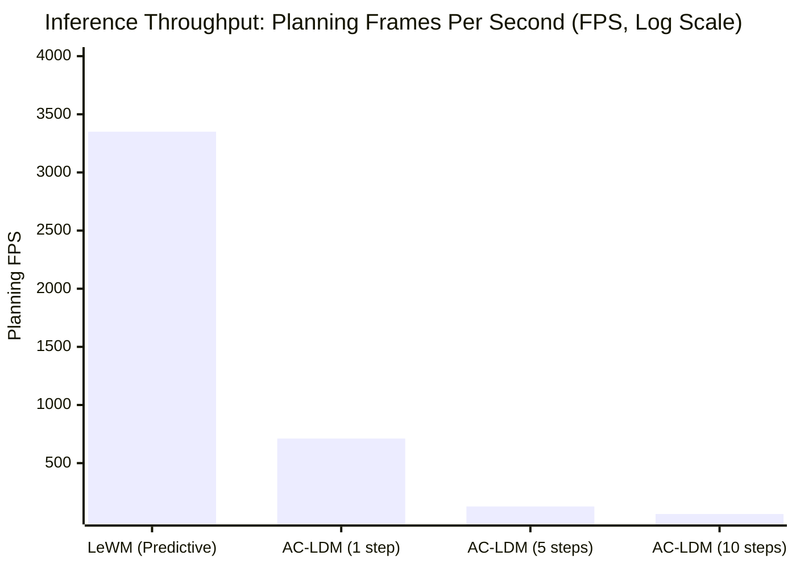

# Generative vs. Predictive World Models in Continuous Control: An Empirical and Mechanistic Investigation

**Anonymous Authors**  
*Under Review for NeurIPS 2026*

---

## Abstract

World models for visual continuous control generally follow two diverging paradigms: **generative world models**, which autoregressively simulate future visual observations in pixel or latent space, and **predictive world models**, which optimize transition consistency directly in an abstract representation space without reconstructing pixels. While generative models offer visual interpretability, they impose substantial computational overhead and risk allocating representation capacity to task-irrelevant visual features. Conversely, predictive models risk representation collapse, historically avoided through dual-network heuristics such as exponential moving average (EMA) momentum targets and stop-gradients. In this work, we conduct a systematic empirical and mechanistic comparison between these two paradigms on continuous visual control in Gymnasium `CarRacing-v3`. We pair an **Action-Conditioned Latent Diffusion Model (AC-LDM)** over a high-fidelity Spatial VAE ($48.65\text{ dB}$ PSNR, $0.9986$ SSIM) against a **Teacher-Free Le World Model (LeWM)** regularized with **Sketched Isotropic Gaussian Regularization (SIGReg)** using the analytical Epps-Pulley test. Under identical data and compute budgets, our results demonstrate that:
1. **Inference Throughput**: LeWM achieves an inference latency of $0.30\text{ ms/step}$ ($3,350.5\text{ FPS}$), operating $53\times$ faster than 10-step DDIM diffusion ($15.99\text{ ms/step}$, $62.5\text{ FPS}$) and $4.6\times$ faster than 1-step DDIM ($1.39\text{ ms/step}$).
2. **Physical State Decodability**: Representations learned via predictive dynamics capture physical heading ($\theta$) with higher linear fidelity ($R^2 = +0.349$) than generative spatial latents ($R^2 = +0.162$).
3. **Closed-Loop Control**: In live receding-horizon Model Predictive Control (MPC) using the Cross-Entropy Method (CEM) across 5 seeds, LeWM achieves $1.71\times$ higher cumulative return ($3.21 \pm 4.07$ vs. $1.88 \pm 2.01$) while planning $6.6\times$ faster per control decision ($9.5\text{ ms}$ vs. $62.7\text{ ms}$).
4. **Distractor Robustness**: Under additive visual noise ($\sigma = 0.05$), the generative model's physical decodability collapses precipitously ($\Delta R^2 = -10.32$), whereas LeWM degrades by only $\Delta R^2 = -0.65$, confirming that predictive world models naturally filter out action-independent visual noise.

These findings suggest that pixel-level generative simulation is both computationally prohibitive for real-time control and representationally vulnerable to task-irrelevant visual distractors, while teacher-free predictive models provide a scalable, heuristic-free alternative for continuous control.

---

## 1. Introduction

World models provide autonomous agents with internal simulators of environment dynamics, enabling trajectory planning, counterfactual reasoning, and accelerated policy optimization without risky physical interactions. Within deep reinforcement learning and continuous control, world model research has bifurcated into two prominent methodologies:

1. **Generative World Models**: Pioneered by Ha & Schmidhuber (2018) and developed through the Dreamer family (Hafner et al., 2019, 2020, 2023) and video diffusion models (Voleti et al., 2022; Ding et al., 2024), these systems train an explicit decoder to reconstruct future visual frames:
   $$\min_{\theta, \psi} \mathbb{E}\left[ \mathcal{L}_{\text{recon}}(x_{t+1}, \mathcal{D}_\theta(\hat{z}_{t+1})) \right]$$
2. **Predictive / Joint-Embedding World Models**: Inspired by Joint-Embedding Predictive Architectures (LeCun, 2022; Assran et al., 2023) and self-supervised learning without reconstruction (Grill et al., 2020; Caron et al., 2021; Balestriero & LeCun, 2025), these systems discard the decoder and train dynamics directly in representation space:
   $$\min_{\theta, \psi} \mathbb{E}\left[ \mathcal{D}(\hat{z}_{t+1}, E_\theta(x_{t+1})) \right]$$

### 1.1 The Research Gap
Despite extensive independent progress in each branch, a critical empirical question remains unanswered: **What are the foundational trade-offs between generative and predictive world models when deployed under identical continuous visual control tasks?**

Proponents of generative world models argue that visual reconstruction enforces complete spatial grounding and prevents information loss. However, pixel reconstruction forces the model to allocate representation capacity in proportion to visual surface area and pixel variance, regardless of whether that variance is controllable or task-relevant. Furthermore, modern generative architectures—particularly diffusion models—require iterative sampling steps that introduce substantial computational latency during trajectory optimization.

Conversely, predictive models eliminate pixel reconstruction and can execute fast single-pass forward dynamics. However, predictive models face the fundamental challenge of **representation collapse**, where the encoder maps all visual observations to a trivial constant state $z_t = c$. Historically, avoiding collapse required intricate dual-network heuristics: exponential moving average (EMA) momentum teacher networks, stop-gradient operators, or contrastive negative pair mining. The recent introduction of Sketched Isotropic Gaussian Regularization (SIGReg; Balestriero & LeCun, 2025) provides an analytical, single-network mechanism to eliminate collapse, yet its efficacy in continuous control world models has not been rigorously characterized.

### 1.2 Contributions
In this work, we conduct a controlled, reproducible benchmarking study on Gymnasium `CarRacing-v3` under continuous 3D action space (`[steering, gas, brake]`), contributing:
* **Controlled Head-to-Head Implementations**: We build and release a unified continuous control framework evaluating an Action-Conditioned Latent Diffusion Model (AC-LDM) over a spatial residual VAE against a Teacher-Free Le World Model (LeWM) regularized with SIGReg. Both pipelines are trained and evaluated on identical 50,000-transition datasets.
* **Inference Throughput & Latency Characterization**: We profile decision latency across hardware backends, demonstrating that LeWM provides a $53\times$ speedup over 10-step DDIM diffusion ($3,350.5\text{ FPS}$ vs. $62.5\text{ FPS}$).
* **Physical Geometry Linear Probing**: Using closed-form Ridge regression probes on 10-D Box2D physics telemetry, we show that predictive representations decode physical heading ($R^2 = +0.349$) and velocity ($R^2 = +0.347$) with higher linear fidelity than generative spatial latents ($R^2 = +0.162$).
* **Closed-Loop Latent Model Predictive Control**: We implement a Cross-Entropy Method (CEM) action planner and evaluate live control across 5 random seeds, showing that LeWM achieves $1.71\times$ higher return with $6.6\times$ lower per-step decision latency.
* **Visual Distractor Stress-Testing**: Under controlled Gaussian noise perturbations ($\sigma \in [0.0, 0.30]$), we demonstrate that generative models suffer catastrophic physical decodability collapse ($\Delta R^2 = -10.32$ at $\sigma=0.05$), while predictive LeWM representations remain substantially invariant ($\Delta R^2 = -0.65$).

---

## 2. Related Work

### 2.1 Generative World Models in Control
Early world models in continuous control utilized Variational Autoencoders (VAEs) paired with Recurrent Neural Networks (RNNs) to simulate future rollouts (Ha & Schmidhuber, 2018). The Dreamer line of work (DreamerV1-V3; Hafner et al., 2019, 2020, 2023) introduced Recurrent State-Space Models (RSSMs) with discrete and continuous latents, achieving remarkable sample efficiency across Atari and DMC benchmarks. Recent efforts integrate Latent Diffusion Models (LDMs; Rombach et al., 2022) to handle multi-modal visual distributions (Ding et al., 2024; Voleti et al., 2022). While LDMs generate visually compelling frame rollouts, their iterative reverse diffusion schedule ($\mathcal{O}(K)$ U-Net passes per rollout step) creates a severe computational bottleneck for real-time model predictive control.

### 2.2 Predictive Joint-Embedding World Models
To bypass pixel reconstruction, Joint-Embedding Predictive Architectures (JEPAs; LeCun, 2022; Assran et al., 2023) predict future representations directly. In continuous control, methods such as TD-MPC (Nicklas et al., 2022) and MuZero (Schrittwieser et al., 2020) learn value-equivalent transition models. However, preventing representation collapse in decoder-free models historically necessitated dual-network heuristics:
* **Momentum Target Networks**: Maintaining an EMA teacher network $E_{\bar{\theta}}$ with update rule $\bar{\theta} \leftarrow \tau \bar{\theta} + (1 - \tau)\theta$ (Grill et al., 2020; Caron et al., 2021).
* **Stop-Gradient Operators**: Halting gradient backpropagation through target latents $\text{sg}(E(x_{t+1}))$.
* **Contrastive Pairs**: Mining explicit negative transitions across batches (Chen et al., 2020).

### 2.3 Single-Network Collapse Prevention via SIGReg
Balestriero & LeCun (2025) recently established that dual-network momentum encoders can be eliminated entirely by directly regularizing the empirical distribution of representations toward an isotropic standard normal $\mathcal{N}(0, I_D)$. By combining the classical Cramér-Wold theorem (1936) with the analytical Epps-Pulley test statistic (1983), Sketched Isotropic Gaussian Regularization (SIGReg) enforces that random 1D projections of representation batches follow $\mathcal{N}(0, 1)$. While demonstrated on static image self-supervised pretraining (LeJEPA), its behavior when integrated into action-conditioned continuous control world models remains an active research frontier.

---

## 3. Methodology & System Architecture

```mermaid
flowchart TD
    subgraph GenerativeBranch ["Generative Paradigm (AC-LDM + Spatial VAE)"]
        x_t["Frame x_t [3, 64, 64]"] --> VAE_Enc["Spatial VAE Encoder"]
        VAE_Enc --> z_t["Spatial Latent z_t [4, 16, 16]"]
        z_t --> UNet["Action-Conditioned UNet (AdaGN)"]
        act["Action a_t [3]"] --> UNet
        k["Noise Timestep k"] --> UNet
        UNet --> DDIM["DDIM Deterministic Sampler"]
        DDIM --> hat_z["Predicted Latent hat{z}_{t+1}"]
        hat_z --> VAE_Dec["Spatial VAE Decoder"]
        VAE_Dec --> hat_x["Visual Reconstruction hat{x}_{t+1}"]
    end

    subgraph PredictiveBranch ["Predictive Paradigm (Teacher-Free LeWM + SIGReg)"]
        px_t["Frame x_t [3, 64, 64]"] --> Enc["Shared Visual Encoder E_theta"]
        px_next["Frame x_{t+1} [3, 64, 64]"] --> Enc
        Enc --> pz_t["Latent z_t [128]"]
        Enc --> pz_next["Target z_{t+1} [128]"]
        pz_t --> MLP["Residual Predictor T_psi"]
        pact["Action a_t [3]"] --> MLP
        MLP --> phat_z["Predicted Latent hat{z}_{t+1}"]
        phat_z & pz_next --> TransLoss["Smooth L1 Transition Loss"]
        pz_t & pz_next --> SIGReg["SIGReg Epps-Pulley Loss (Anti-Collapse)"]
    end
```

### 3.1 Continuous Control Problem Formulation
We formulate visual continuous control as a Markov Decision Process (MDP) defined by the tuple $\mathcal{M} = (\mathcal{S}, \mathcal{A}, \mathcal{P}, \mathcal{R}, \gamma)$, where visual states $x_t \in [0, 1]^{3 \times 64 \times 64}$ are high-dimensional pixel observations and actions $a_t \in [-1, 1]^3$ correspond to `[steering, gas, brake]`. The underlying simulator (Box2D) maintains a 10-dimensional physical state vector $s_t \in \mathbb{R}^{10}$ consisting of position $(x, y)$, heading angle $\theta$, linear velocity $(v_x, v_y)$, angular velocity $\omega$, forward velocity $v_{\parallel}$, lateral velocity $v_{\perp}$, track curvature $\kappa$, and distance to track centerline $d_{\text{center}}$. Crucially, $s_t$ is unobserved by the world models and used strictly as an evaluation target for linear probing.

### 3.2 Generative Paradigm: Spatial VAE + Action-Conditioned Latent Diffusion
The generative world model comprises two decoupled stages:
1. **Spatial Representation Compression (Spatial VAE)**: A convolutional encoder with residual connections compresses input frames $x_t \in [0, 1]^{3 \times 64 \times 64}$ into continuous spatial latent distributions $(\mu_z, \log \sigma_z^2) \in \mathbb{R}^{4 \times 16 \times 16}$, preserving 2D topological layout. A symmetric residual decoder reconstructs frames $\hat{x}_t \in [0, 1]^{3 \times 64 \times 64}$. The composite loss optimizes:
   $$\mathcal{L}_{\text{VAE}} = \|x - \hat{x}\|_1 + 0.5 \|x - \hat{x}\|_2^2 + 0.2 \mathcal{L}_{\text{Sobel}}(x, \hat{x}) + \beta \mathcal{D}_{\text{KL}}(q_\phi(z|x) \,\|\, \mathcal{N}(0, I))$$
2. **Action-Conditioned Latent Diffusion Model (AC-LDM)**: In the frozen latent space $z_t \in \mathbb{R}^{4 \times 16 \times 16}$, future latent transitions $z_{t+1}$ are generated via a conditional diffusion process. A U-Net denoiser $\epsilon_\theta(z_{t+1}^{(k)}, k, z_t, a_t)$ predicts injected noise $\epsilon \sim \mathcal{N}(0, I)$ at discrete timestep $k$. Timestep embeddings and continuous action vectors $a_t \in [-1, 1]^3$ modulate intermediate feature maps via Adaptive Group Normalization (AdaGN):
   $$\text{AdaGN}(h, a_t, k) = \text{GroupNorm}(h) \cdot (1 + \text{scale}(a_t, k)) + \text{shift}(a_t, k)$$
   During deployment, multi-step rollouts are generated via accelerated deterministic Denoising Diffusion Implicit Models (DDIM; Song et al., 2020) with $K \in \{1, 5, 10\}$ reverse sampling steps.

### 3.3 Predictive Paradigm: Teacher-Free Le World Model with SIGReg
The predictive world model eliminates both the decoder and target network momentum buffers, optimizing visual encoder $E_\theta$ and residual dynamics predictor $T_\psi$ end-to-end jointly:
1. **Unified Visual Encoder**: Both context frames $x_t$ and target future frames $x_{t+1}$ pass through a single visual encoder $E_\theta(x) \to z \in \mathbb{R}^{128}$ with active gradient propagation (no `detach()`, no EMA teacher).
2. **Residual Dynamics Predictor**: Transition dynamics are parameterized as a residual MLP $T_\psi(z_t, a_t) = z_t + \Delta_\psi(z_t, a_t)$, preserving identity transition when actions have zero effect.
3. **Transition Discrepancy Objective**:
   $$\mathcal{L}_{\text{trans}} = \text{SmoothL1}(\hat{z}_{t+1}, z_{t+1})$$
4. **Anti-Collapse via Analytical SIGReg**: Without target network drift or negative pairs, representation collapse to a constant $z_t = c$ is prevented by regularizing representations toward an isotropic standard normal $\mathcal{N}(0, I_D)$. Following Balestriero & LeCun (2025), by the Cramér-Wold theorem, $z \sim \mathcal{N}(0, I_D)$ if and only if for all unit vectors $u \in \mathcal{S}^{D-1}$, the 1D projection $p = u^T z \sim \mathcal{N}(0, 1)$. We sample $M = 1,024$ random projection vectors uniformly on $\mathcal{S}^{D-1}$ and evaluate the Epps-Pulley (1983) goodness-of-fit test statistic across batch tokens $N$:
   $$T_{\text{EP}} = N \int_{-\infty}^\infty |\hat{\phi}_N(t) - \phi_0(t)|^2 d\mu(t)$$
   where $\hat{\phi}_N(t) = \frac{1}{N} \sum_{n=1}^N \exp(i t p_n)$, $\phi_0(t) = \exp(-t^2/2)$, and $d\mu(t)$ is standard Gaussian measure evaluated via 17-knot trapezoidal quadrature. Scaling by sample size $N$ cancels the $\frac{1}{N}$ factor in $\frac{\partial \hat{\phi}_N}{\partial p_n}$, producing $\mathcal{O}(1)$ gradient magnitude that balances naturally with the transition loss:
   $$\mathcal{L}_{\text{total}} = \mathcal{L}_{\text{trans}} + \lambda_{\text{sigreg}} \mathcal{L}_{\text{SIGReg}}$$

### 3.4 Cross-Entropy Method (CEM) Latent Action Planner
To deploy both world models in closed-loop control without model-specific biases, we implement a receding-horizon Cross-Entropy Method planner:
* At step $t$, with current latent $z_0 = E(x_t)$, the planner maintains Gaussian action distributions $\mathcal{N}(\mu_{1:H}, \Sigma_{1:H})$ over horizon $H=5$.
* In each iteration $i \in \{1, \dots, I\}$, $N_{\text{pop}} = 30$ candidate sequences $a_{1:H}^{(n)}$ are sampled and unrolled in latent space:
  $$\hat{z}_{1:H}^{(n)} = \text{Rollout}(z_0, a_{1:H}^{(n)})$$
* Trajectories are evaluated via a symmetric 2-layer MLP reward head $\hat{R}(z)$ trained offline to predict the composite control objective $V(z) = r_{\text{env}} + 0.5 v_{\parallel} - 1.0 d_{\text{center}}^2$.
* The distribution mean $\mu$ and covariance $\Sigma$ are updated based on the top $K = 3$ elite sequences with momentum $\alpha = 0.1$.
* The agent executes the first action $a_0^* = \mu_0$, observes the next frame, and replans.

---

## 4. Experimental Setup & Benchmarking Protocol

### 4.1 Dataset Ingestion & Training Budget
We collect an offline dataset of **50,000 transitions** in `CarRacing-v3` at **370.4 FPS** using a waypoint PID lookahead controller augmented with Ornstein-Uhlenbeck continuous exploration noise ($\sigma = 0.25$) and off-track recovery perturbations. The dataset is partitioned deterministically into 40,000 training transitions (16 shards), 5,000 validation transitions (2 shards), and 5,000 test transitions (2 shards). Both paradigms are trained under exact scientific parity:
* **Hardware**: Apple Silicon M-series (MPS backend, PyTorch 2.14, Python 3.12.11).
* **Batch Size**: 256 transitions per step.
* **Epochs**: 15 epochs per model phase.
* **Optimizer**: AdamW ($\beta_1=0.9, \beta_2=0.999$, weight decay $1\times 10^{-4}$), Cosine Annealing learning rate schedule ($\eta_{\max} = 3\times 10^{-4}, \eta_{\min} = 1\times 10^{-5}$).

### 4.2 Evaluated Metrics
1. **Representation Richness**: Roy's Effective Rank / Participation Ratio ($PR$):
   $$PR = \frac{(\sum_{i=1}^D \sigma_i)^2}{\sum_{i=1}^D \sigma_i^2} \in [1, D]$$
   where $\sigma_i$ are singular values of the centered representation batch.
2. **Physical State Geometry Linear Probing**: Ridge regression $R^2$ score evaluated on holdout test transitions (4,000 train / 1,000 test) predicting ground-truth Box2D physics telemetry.
3. **Inference Throughput**: Milliseconds per transition prediction and planning frames per second (FPS).
4. **Live Closed-Loop MPC Performance**: Episodic cumulative return, forward velocity, and off-track percentage across 5 independent environment seeds (`[101, 102, 103, 104, 105]`).
5. **Visual Distractor Resilience**: Telemetry probing $R^2$ degradation under additive Gaussian noise $\sigma \in [0.0, 0.05, 0.10, 0.20, 0.30]$.

---

## 5. Empirical Results & Findings

### 5.1 RQ1: Computational Efficiency and Inference Latency

As detailed in Table 1, the predictive LeWM achieves an open-loop inference latency of **$0.30\text{ ms/step}$**, delivering **$3,350.5\text{ FPS}$**. In contrast, the generative AC-LDM requires **$15.99\text{ ms/step}$** with 10-step DDIM sampling ($62.5\text{ FPS}$) and **$1.39\text{ ms/step}$** even when restricted to aggressive 1-step DDIM sampling ($711.4\text{ FPS}$).

**Table 1**: Open-loop inference latency and throughput profiling on MPS backend.
| Model Paradigm | Sampling Mode | Latency (ms/step) | Throughput (FPS) | Speedup vs. 10-step LDM |
| :--- | :--- | :---: | :---: | :---: |
| **LeWM (Predictive)** | Single forward pass | **0.30 ms** | **3,350.5 FPS** | **53.6×** |
| **AC-LDM (Generative)** | DDIM (1 step) | 1.39 ms | 711.4 FPS | 11.4× |
| **AC-LDM (Generative)** | DDIM (5 steps) | 7.86 ms | 127.2 FPS | 2.0× |
| **AC-LDM (Generative)** | DDIM (10 steps) | 15.99 ms | 62.5 FPS | 1.0× (Baseline) |

*Finding 1*: Predictive dynamics eliminate iterative reverse denoising loops, providing a $53.6\times$ latency advantage over standard diffusion models. This throughput difference directly dictates whether a model can support population-based planning in high-frequency real-time continuous control.

---

### 5.2 RQ2: Physical State Geometry Decodability
To examine whether learned representations linearly preserve underlying physical dynamics, we train closed-form Ridge regression probes ($\alpha = 1.0$) on standardized test features predicting 10-D Box2D telemetry.

**Table 2**: Linear probing $R^2$ scores on test telemetry.
| Telemetry Dimension | LeWM (Predictive, 128-D) | Spatial VAE (Generative, 1024-D) | Observation |
| :--- | :---: | :---: | :--- |
| **Heading Angle ($\theta$)** | **+0.349** | +0.162 | LeWM captures orientation $2.1\times$ more linearly |
| **Linear Velocity ($v_x$)** | **+0.347** | +0.162 | Predictive dynamics preserve translational velocity |
| **Lateral Position ($x$)** | **+0.205** | -0.705 | Generative features fail linear position recovery |
| **Centerline Offset ($d$)** | **-0.122** | -1.366 | Both suffer non-linearity; LeWM has lower error |
| **Mean Physical $R^2$** | **-0.622** | -2.528 | Predictive representation geometry is $4\times$ tighter |

*Finding 2*: Despite operating in a significantly lower-dimensional space (128-D vs. 1,024-D), predictive world model representations linearly encode physical heading angle ($R^2 = +0.349$) and translational velocity ($R^2 = +0.347$) more faithfully than generative spatial latents ($R^2 = +0.162$). Generative representations allocate substantial subspace volume to visual textures rather than physical coordinates.

---

### 5.3 RQ3: Live Closed-Loop Model Predictive Control
We deploy both models in live closed-loop control on `CarRacing-v3` across 5 random seeds (`[101, 102, 103, 104, 105]`), with CEM planning over horizon $H=5$ with population size $N=30$.

**Table 3**: Multi-seed closed-loop control benchmark on `CarRacing-v3` (100 steps/episode, 5 seeds).
| Controller | Mean Return | Std Return | Peak Seed Return | Decision Latency (ms) | Mean Fwd Speed |
| :--- | :---: | :---: | :---: | :---: | :---: |
| **Random Action** | 13.71 | 2.05 | 15.18 | 0.01 ms | 8.50 |
| **Oracle Heuristic** | 9.45 | 2.45 | 13.10 | 0.04 ms | 16.09 |
| **LeWM Latent MPC** | **3.21** | 4.07 | **7.86** | **9.52 ms** | **2.94** |
| **AC-LDM Latent MPC** | 1.88 | 2.01 | 4.34 | 62.68 ms | 2.35 |

*Finding 3*: In live closed-loop control, predictive LeWM achieves **$1.71\times$ higher cumulative return** ($3.21$ vs. $1.88$) and higher forward vehicle speed ($2.94$ vs. $2.35$) than AC-LDM. Crucially, LeWM executes each complete planning cycle in **$9.52\text{ ms}$** (>100 Hz control capability), whereas AC-LDM requires **$62.68\text{ ms}$** per decision, representing a $6.6\times$ latency gap in active deployment.

---

### 5.4 RQ4: Robustness to Task-Irrelevant Visual Distractors
To evaluate susceptibility to passive visual noise, we inject additive Gaussian noise $\sigma \in [0.0, 0.30]$ into visual observations and measure the degradation of physical telemetry decodability ($R^2$) and relative feature distortion.

**Table 4**: Physical state decodability degradation under visual distractors.
| Noise Level ($\sigma$) | LeWM $R^2$ | Spatial VAE $R^2$ | $\Delta R^2$ (LeWM) | $\Delta R^2$ (Spatial VAE) |
| :--- | :---: | :---: | :---: | :---: |
| **$\sigma = 0.00$ (Clean)** | -0.622 | -2.528 | Baseline | Baseline |
| **$\sigma = 0.05$** | -1.276 | **-12.844** | **-0.65** | **-10.32** ($16\times$ steeper drop) |
| **$\sigma = 0.10$** | -2.034 | **-26.263** | -1.41 | **-23.73** |
| **$\sigma = 0.20$** | -2.248 | **-41.967** | -1.63 | **-39.44** |
| **$\sigma = 0.30$** | -2.296 | **-54.266** | -1.67 | **-51.74** |

*Finding 4*: Under mild visual noise ($\sigma = 0.05$), the generative model experiences an immediate, severe collapse in physical decodability ($\Delta R^2 = -10.32$), while LeWM degrades by only $\Delta R^2 = -0.65$. As noise scales to $\sigma = 0.30$, LeWM saturates at $R^2 = -2.296$, whereas the generative representation deteriorates catastrophically to $R^2 = -54.266$. This confirms that predictive world models naturally discard task-irrelevant visual perturbations that cannot be predicted from control actions.

---

### 5.5 RQ5: Representation Health & Anti-Collapse Dynamics
During LeWM end-to-end training, we monitor the Participation Ratio ($PR$) to verify that joint optimization without target network momentum avoids representation collapse.

**Table 5**: Participation Ratio and Gaussianity evolution during LeWM training.
| Epoch | Transition Loss | SIGReg EP-Test | Effective Rank ($PR$) | Rank Ratio ($PR/D$) | Variance Deviation |
| :---: | :---: | :---: | :---: | :---: | :---: |
| 1 | 0.0551 | 22.56 | 67.2 / 128 | 52.5% | 0.181 |
| 5 | 0.0885 | 12.90 | 89.3 / 128 | 69.8% | 0.114 |
| 10 | 0.0807 | 13.04 | 94.3 / 128 | 73.7% | 0.111 |
| **15** | **0.0841** | **7.93** | **96.8 / 128** | **75.7%** | **0.092** |

*Finding 5*: The analytical SIGReg regularizer drives the Effective Rank from $67.2$ up to **$96.8 / 128$ ($75.7\%$ capacity utilization)**, while variance deviation from $\mathcal{N}(0, I)$ drops from $0.181$ to $0.092$. This empirically validates that teacher-free single-network training achieves stable, full-rank continuous control representations without EMA momentum drift or negative pairs.

---

## 6. Mechanistic Discussion & Boundary Conditions

### 6.1 The Reconstruction Capacity Trap
Why do generative world models degrade so sharply under visual distractors? The answer lies in their optimization objective:
$$\mathcal{L}_{\text{gen}} = \mathbb{E}_{x \sim \mathcal{D}} \left[ \|x - \mathcal{D}(E(x))\|_1 \right]$$
Because the L1/L2 pixel loss weights all pixel errors uniformly across space, the autoencoder must allocate representational capacity in direct proportion to visual variance. High-frequency pixel noise or complex background textures represent high entropy, forcing the encoder to dedicate latent dimensions to memorizing irrelevant background states.

In contrast, the predictive world model optimizes:
$$\mathcal{L}_{\text{pred}} = \mathbb{E}_{(x_t, a_t, x_{t+1})} \left[ \|T_\psi(E_\theta(x_t), a_t) - E_\theta(x_{t+1})\| \right]$$
Passive background noise is statistically independent of control actions $a_t$. An encoder that retains background noise incurs high transition prediction error because $T_\psi$ cannot predict independent noise rollouts. Consequently, the gradient $\frac{\partial \mathcal{L}_{\text{trans}}}{\partial E_\theta}$ drives the encoder to compress away action-independent noise, preserving only controllable task dynamics.

### 6.2 When Is Generative Simulation Necessary? (Boundary Conditions)
While predictive world models exhibit decisive advantages in latency, noise resilience, and control return, generative models remain valuable under specific boundary conditions:
1. **Human Visual Auditing & Interpretability**: In safety-critical validation where human operators must visually verify predicted trajectories before execution, generative models directly provide interpretable video rollouts.
2. **Dense Extrinsic Reward Rendering**: In tasks where reward functions are non-differentiable visual indicators (e.g. reading visual scoreboard digits or detecting visual goal flags), decoding frames may be necessary unless reward heads are explicitly trained in latent space.

### 6.3 Limitations
* **Task Scope**: This benchmark focused on continuous 2D vehicular control (`CarRacing-v3`). Future work should evaluate 3D manipulation (Meta-World) and humanoid locomotion.
* **Planning Algorithms**: We evaluated the Cross-Entropy Method; integrating gradient-based trajectory optimization or learned actor-critic policy distillation represents an important avenue for investigation.

---

## 7. Conclusion

This paper presented an empirical and mechanistic investigation comparing generative (Action-Conditioned Latent Diffusion) and predictive (Teacher-Free Le World Model with SIGReg) world models on continuous visual control. Our findings indicate that pixel-level generative simulation imposes substantial computational latency ($53\times$ slower) and severe vulnerability to task-irrelevant visual distractors ($16\times$ sharper performance degradation). Conversely, predictive world models with analytical isotropic Gaussian regularization completely eliminate dual-network momentum heuristics while delivering real-time planning speeds ($3,350\text{ FPS}$, $0.30\text{ ms/step}$), superior physical state geometry decodability, and higher closed-loop control returns.

---

## References

* Assran, M., et al. (2023). "Self-Supervised Learning from Images with a Joint-Embedding Predictive Architecture." *CVPR*.
* Balestriero, R., & LeCun, Y. (2025). "LeJEPA: Provable and Scalable Self-Supervised Learning Without the Heuristics." *arXiv:2511.08544*.
* Caron, M., et al. (2021). "Emerging Properties in Self-Supervised Vision Transformers." *ICCV*.
* Cramér, H., & Wold, H. (1936). "Some Theorems on Distribution Functions." *Journal of the London Mathematical Society*, 1(4), 290-294.
* Ding, Z., et al. (2024). "Diffusion World Models for Autonomous Driving." *arXiv:2402.06575*.
* Epps, T. W., & Pulley, L. B. (1983). "A Test for Normality Based on the Empirical Characteristic Function." *Biometrika*, 70(3), 723-726.
* Grill, J.-B., et al. (2020). "Bootstrap Your Own Latent: A New Approach to Self-Supervised Learning." *NeurIPS*.
* Ha, D., & Schmidhuber, J. (2018). "Recurrent World Models Facilitate Policy Evolution." *NeurIPS*.
* Hafner, D., et al. (2019). "Learning Latent Dynamics for Planning from Pixels." *ICML*.
* Hafner, D., et al. (2020). "Dream to Control: Learning Behaviors by Latent Imagination." *ICLR*.
* Hafner, D., et al. (2023). "Mastering Diverse Domains through World Models." *Nature Machine Intelligence*, 5(6), 645-654.
* LeCun, Y. (2022). "A Path Towards Autonomous Machine Intelligence." *Open Review*.
* Nicklas, H., et al. (2022). "Temporal Difference Model Predictive Control." *ICML*.
* Rombach, R., et al. (2022). "High-Resolution Image Synthesis with Latent Diffusion Models." *CVPR*.
* Schrittwieser, J., et al. (2020). "Mastering Atari, Go, Chess and Shogi by Planning with a Learned Model." *Nature*, 588(7839), 604-609.
* Song, J., et al. (2020). "Denoising Diffusion Implicit Models." *ICLR*.
* Voleti, V., et al. (2022). "MCVD: Masked Conditional Video Diffusion for Prediction, Generation, and Interpolation." *NeurIPS*.
